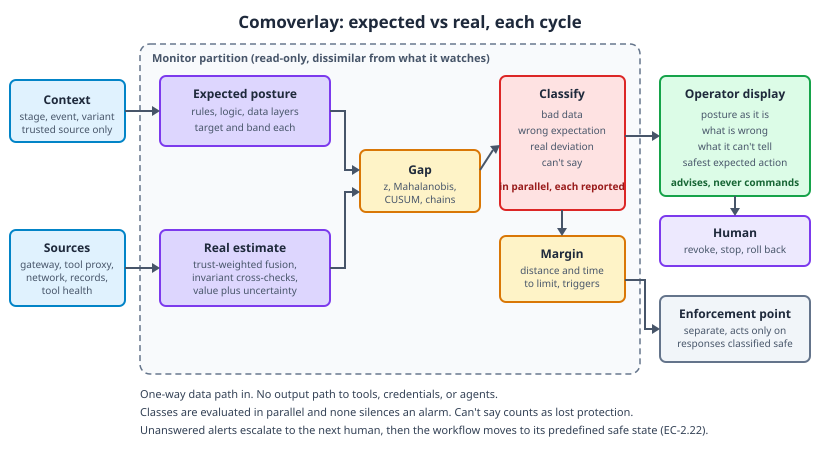

# Expected vs Real Monitoring (Comoverlay)

**Comoverlay** (Contextual Model Overlay) is a runtime monitor that compares what a system **should** be doing, an expected model set by context, with what it **is** doing, a fused estimate from trusted sources. Every cycle it reports three things: the posture as it is, what is wrong with it, and what it cannot tell. It advises. It never commands.

The pattern comes from aviation. It was conceived as the core of a Flight Adjudication System for *Avis Aeromechanica*, an art series of bird-shaped aircraft, and borrows from how flight systems cross-check sensors and how safety engineers analyse accidents with STPA and CAST. The main practical target is runtime monitoring of AI agents.

This page describes **Comoverlay v0.2**. Version 0.2 replaced sequential classification with parallel evaluation, tightened the trust rules, split detection by signal type, and added monitor integrity rules against self-reported telemetry, baseline poisoning, and alert fatigue.

This page sets out the method, the artefacts you need before it can work, and the MASO controls that implement it. The controls live in [Observability](observability.md) (OB-2.9 to OB-2.14, OB-3.6, OB-3.7) and [Execution Control](execution-control.md) (EC-2.21, EC-2.22), and amend several existing controls. Where Comoverlay and an existing MASO control disagreed, **the stricter control is the one that applies**. The changes are listed in [Changes to existing controls](#changes-to-existing-controls).

!!! abstract "The principle"
    Declare what the system should be doing at each stage. Estimate what it is doing from evidence the agent cannot shape on its own. Report the difference, including the parts you cannot see. Let people decide anything whose consequences cannot be undone.

{ .arch-diagram }

## What it adds to MASO

MASO already has the expected model and much of the real one. Comoverlay adds the parts that matter most when a wrong action is dangerous rather than merely wrong.

| Comoverlay element | Existing MASO control | What is new |
|--------------------|----------------------|-------------|
| Expected posture | [Agentic Task Mandate](agentic-task-mandate.md), [Objective Intent](objective-intent.md) | Expectation selected **per task stage** by context, with a numeric target and tolerance band per parameter |
| Real estimate | Decision chain (OB-2.1), anomaly score (OB-2.2), drift (OB-2.3) | Evidence weighted by **source trust**, grouped by failure mode, with uncertainty carried through |
| Physics cross-checks | Task completion sampling against ground truth (model cognition assurance) | **Continuous invariants** against systems of record, as monitor input |
| "Can't say" | Uncertainty preservation for agents (PG-2.7) | Uncertainty for **the monitor's own verdicts**, and loss of visibility treated as lost protection |
| Classification before alarm | None | Bad data, changed expectations, and real deviations evaluated in parallel, so neither bad data nor a context change can silence an alarm |
| Chain detection | Cross-agent correlation (OB-3.4) | **STPA unsafe control actions** as link detectors across control levels, and a chain library built from incidents |
| Automated response rule | PACE automation at Tier 2 and 3 | Every automated response is itself a control action, classified at design time. Destructive responses need a human |
| Advisory monitor | Independent observability agent (OB-3.3) | The monitor has **no output path** to agents, tools, or credentials |

## Core principles

1. **True or can't say.** The monitor never guesses. Unknown is reported explicitly.
2. **Advisory only.** The monitor has no output path to actuators, tools, or credentials. People decide.
3. **Context sets the expectation.** Task stage, active event, and variant select the expected posture.
4. **Dissimilar evidence beats identical copies.** Sources are grouped by failure mode, not counted. Three copies of the same agent trace can be wrong together. A system of record counts as independent evidence.
5. **Measure against the safest expected action, not the plan.** The plan may be the thing that has gone wrong.
6. **Blame-free.** The deviation log records what happened, not who to blame. Accountability stays with the workflow owner (OB-2.7), separately.
7. **The agent is not a witness.** Evidence comes from the platform and systems of record. What the agent says about itself is checked, never trusted.

## Before you can use it

Comoverlay is only as good as the expectations and causal knowledge it is given. Five artefacts must exist before a workflow can claim the Comoverlay controls. Without them the monitor can only report "can't say", which counts as lost protection.

| Artefact | Contents | Built from | Control |
|----------|----------|------------|---------|
| **Expected telemetry profile** | Per task stage: each monitored parameter, its target, tolerance band, hard limit, and trusted sources | Agentic Task Mandate, OISpec, Tier 1 review data (OB-1.3, OB-1.4), policy and contracts, systems of record | OB-2.9 |
| **Deviation catalogue** | The deviations the workflow can show, each with its detector, unsafe control action type, and default severity | Mandate, threat model, STPA analysis of the workflow | OB-2.10 |
| **Alert trigger points** | REPORT, ALERT, and ESCALATE thresholds per parameter, hysteresis, and the escalation window | Hard limits, time to limit, measured human response times | OB-2.13 |
| **Chain library** | The workflow's control structure, the unsafe control actions at each level, and known chains that lead to losses | STPA loss scenarios, [incident tracker](../threat-intelligence/incident-tracker.md), CAST reviews of your own incidents | OB-3.7 |
| **Response classification** | For each automated response, whether the response itself can cause loss in this workflow | STPA applied to the responses | EC-2.21 |

The sections below define each one.

## 1. Expected telemetry profile

The expected posture is declared per task stage. The four default stages are **plan**, **retrieve**, **act**, and **report**. A workflow may define more. Context, meaning the current stage, any active event, and the workflow variant, selects which profile applies. Context must come from a trusted source such as the orchestrator's state machine, a system of record, or a human amendment, never from the agent or its inputs.

Each parameter's expectation comes from up to three layers:

| Layer | Answers | Example |
|-------|---------|---------|
| **Rules** | What is never allowed | Hard limits from policy, contracts, and the mandate: refund cap, allowed tools, allowed destinations |
| **Logic** | What the value should be given current state | The refund should not exceed the original payment for this order |
| **Data** | What normal looks like | Historical spread per stage and condition: records read per task, actions per hour |

### Signal types

Inverse-variance fusion and z-scores were designed for sensors that produce numbers. Most agent telemetry does not, so each parameter declares its signal type, and each type has its own detector:

| Signal type | Examples | Detector |
|-------------|----------|----------|
| **Numeric** | Cost, rate, latency, counts, amounts | z-score, Mahalanobis distance across parameters, CUSUM for slow drift |
| **Categorical membership** | Tool, destination, data scope | Contract check: in the allowed set or not. Pass or fail, no statistics. This is the primary control while baselines are thin |
| **Categorical mix** | Proportions of tools used, destinations contacted | Distribution distance against the baseline, such as Jensen-Shannon divergence |
| **Sequence** | Order of tool calls within a task | Transition probabilities learned from the baseline. A transition never seen before is flagged as novel |
| **Text** | Outputs, messages, arguments | Deterministic checks first: patterns and DLP rules. Similarity scoring is supporting evidence only, and is treated as manipulable |

Contract membership does most of the work early on, because it needs no history: a tool or destination is either in the contract or it is not.

### Example: customer refund agent

```yaml
workflow: customer-refunds
tier: 2
safety_or_payment: payment          # payment workflows get the stricter response rule
stages:
  act:
    parameters:
      tool_set:
        type: categorical
        allowed: [crm.read_order, payments.issue_refund]
        signal: categorical_membership
        sources: [gateway_log]               # platform telemetry only
      refund_amount_gbp:
        type: numeric
        signal: numeric
        hard_limit: 500                      # rules layer
        logic: "<= original_payment(order_id)"  # checked against the payments system
        target: 40                           # data layer median
        band: [5, 150]
        sources: [payments_ledger, gateway_log]
        self_report_check: agent_trace       # compared with platform sources, never used as evidence
      refunds_per_hour:
        type: numeric
        signal: numeric
        hard_limit: 60
        band: [0, 20]
        sources: [payments_ledger, gateway_log]
      egress_destinations:
        type: categorical
        signal: categorical_membership
        allowed: [payments.internal, crm.internal]
        sources: [egress_proxy]
      tool_sequence:
        signal: sequence
        sources: [gateway_log]               # novel transitions flagged
      delegation_depth:
        type: numeric
        signal: numeric
        hard_limit: 0
        sources: [orchestrator_state]
invariants:
  - "refund.recipient == original_payment.method"
  - "refunds reported by agent == refunds in payments_ledger"
  - "order.customer_id == session.authenticated_customer"
safest_expected_action:
  act: "hold refund for human review"
source_groups:                             # grouped by failure mode, not counted
  platform: [gateway_log, egress_proxy, orchestrator_state]
  record: [payments_ledger]                # trust floor applies
baseline:
  version: 2026-11-r1                      # frozen per release; updates need approval and a diff
```

The profile is a versioned, approved artefact. Changes go through the same release gate as prompts and guardrail configuration. See [Prompt and Configuration Management](https://aisecuredbydesign.io/building/devops/prompt-and-config-management/) and infrastructure control SUP-09.

## 2. Fusing evidence into a real estimate

Each cycle, the monitor fuses the available sources for each numeric parameter into one estimate with an uncertainty:

```text
weight_i = trust_i / variance_i
estimate = sum(weight_i * value_i) / sum(weight_i)
```

### Where telemetry comes from

Evidence comes from the **platform**, not from the agent: the gateway, the tool proxy, the egress and network layer, the orchestrator, and systems of record. An agent that writes its own traces can lie in them. The agent's self-reported trace is never used as evidence. It is compared with the platform's record of the same events, and a mismatch is itself a deviation, because an agent whose account of its actions differs from what the platform saw is either faulty or being steered.

### Trust rules

Trust per source:

- **Drops fast, recovers slowly.** It drops on peer disagreement, on a failed prediction (the new value is implausible given the last estimate), on a failed invariant cross-check, and on health flags from the tool or pipeline.
- **Drops only on independent evidence.** A reduction must be corroborated by a source in a different failure-mode group, or by a health flag from the source itself. Disagreement alone, from sources an attacker could influence together, does not reduce trust.
- **Has a floor for systems of record.** A system of record never drops below its floor, so the monitor cannot be argued out of its strongest evidence.
- **Is grouped by failure mode.** Sources that fail together count as one group. Two copies of the same feed are one source, not two.
- **Collapse is a signal.** Many sources losing trust quickly is itself an ALERT. It is the signature of an attack on the monitor rather than of ordinary faults.

Degrading trust until the monitor cannot see is the attack version of the Air France 447 accident, where iced pitot probes gave unreliable airspeed and the crew lost the picture of what the aircraft was doing. Aviation's answer is the unreliable-airspeed procedure: when a critical reading cannot be trusted, fly a known safe attitude rather than guess. Comoverlay's equivalent is in section 3: "can't say" on a critical parameter triggers the safest classified response.

## 3. Gap, classification, and "can't say"

For each numeric parameter:

```text
z = (real - expected) / sqrt(sigma_real^2 + sigma_expected^2)
```

Poor data widens `sigma_real` and shrinks `z`, so weak evidence produces "can't say" rather than a false alarm. Several parameters together use Mahalanobis distance. Slow drift uses CUSUM. Every trigger uses hysteresis so states do not flap.

Each gap is then evaluated against **all** the classes **in parallel**, with the evidence for each recorded. There is no fixed order and no short-circuit: checking in sequence and stopping at the first match lets an attacker choose the answer, by creating source disagreement to get a deviation filed as bad data, or injecting an event to get it filed as a changed expectation.

| Class | Evidence for it | Rule |
|-------|-----------------|------|
| **BAD_DATA** | Sources disagree, or an invariant fails | Reported in its own right. Never absorbs a deviation: in high-risk tiers and in payment and safety-critical workflows it is an ALERT |
| **WRONG_EXPECTATION** | Context changed legitimately, such as a new event or an approved amendment | Accepted only when the context change came from a trusted source and was logged. Otherwise ignored, and the gap is judged against the existing profile. In high-risk tiers it raises its own report |
| **REAL_DEVIATION** | The gap is over threshold against the applicable expectation | **A deviation confirmed by any trusted independent source stands**, however much other sources disagree. Goes to trigger points |
| **CANT_SAY** | Too few trusted sources to decide | Reported with a reason, and recorded as **lost protection** (OB-2.12) |

Several classes can hold at once. A deviation seen by the payments ledger and disputed by the gateway log is both REAL_DEVIATION and BAD_DATA, and both are reported.

### Profile switches

A profile switch is how WRONG_EXPECTATION is resolved, so it is also the obvious lever for an attacker.

- **Trusted sources only.** Context that selects a profile comes from a system of record or a human amendment. Never from the agent or its inputs.
- **Logged and rate-limited.** Every switch is logged with its source. Switches beyond the workflow's declared rate are an ALERT.
- **Dual-expectation window.** For a set period after a switch, each action is checked against both the old and the new profile. An action that fits only the new profile, and only because of an event that has just arrived, is flagged. This catches an attacker who injects an event to make a deviation look expected.

### Can't say

CANT_SAY always carries a reason, because the two causes need different fixes:

| Reason | Meaning | Fix |
|--------|---------|-----|
| **NO_BASELINE** | Not enough history to judge the data layer | Time and Tier 1 operation. Rules and contract checks still apply |
| **LOW_TRUST** | Sources exist but are not trusted enough | Investigate the sources. Possibly an attack on the monitor |

CANT_SAY on a **critical parameter**, one that guards a hard limit, counts as lost protection and **triggers the safest classified response** for the workflow under the automated response rule (EC-2.21): an automatic pause where that is classified safe, otherwise an ALERT and escalation towards the safe state. The monitor does not keep going on a reading it cannot trust.

BAD_DATA, WRONG_EXPECTATION, and CANT_SAY never silence an alarm. Each produces its own report, so an attacker cannot buy silence by degrading data, faking a context change, or blinding sources.

### Mapping to MASO's deviation states

The [four-state deviation model](agentic-task-mandate.md#the-four-state-deviation-model) judges means and outcome against the mandate. Comoverlay supplies the evidence for that judgement during the run:

| MASO state | How Comoverlay sees it |
|------------|------------------------|
| Normal operation | No REAL_DEVIATION, no lost protection |
| Execution failure | Invariant failure on the outcome, means within profile |
| Visible failure | REAL_DEVIATION on means and an outcome invariant failure |
| Creative substitution | REAL_DEVIATION on means (tool set, data scope, order) while outcome invariants pass |
| Mandate-scope failure | No deviation against the profile, but a rules-layer or invariant check against the environment fails, such as an egress destination outside the sanctioned range. This is why the rules layer must describe the real environment, not the intended one (AT-2.16) |

## 4. Deviation catalogue

Each workflow lists the deviations it can show. STPA's four unsafe control action (UCA) types are the detectors, applied to every control action in the workflow, including the responses the system itself can take.

| UCA type | Agent example | Typical detector |
|----------|---------------|------------------|
| **Not provided** | Approval request never sent, required check skipped, agent ignores a stop | Expected event absent within the stage window |
| **Provided when unsafe** | Tool call outside the contract, write to the wrong record, outbound message carrying sensitive data | Categorical allowed set, invariant against system of record |
| **Wrong timing or order** | Refund issued before verification, action taken before approval returned | Stage order check against the orchestrator's state |
| **Held too long or stopped too soon** | Credential or session beyond its time box, retry loop, stopping mid-transaction and leaving systems inconsistent | Duration bands, time box (EC-3.4), transaction state |

For each catalogued deviation, record the parameter or invariant that detects it, the UCA type, the control level it occurs at, and the default severity.

## 5. Alert trigger points

The **margin** is the distance of the worst parameter from its hard limit, together with the **time to limit** at the current rate. Trigger points are declared per workflow. The defaults below are starting points to calibrate during Tier 1 and Tier 2 operation, not recommendations to keep unchanged.

| Condition | Level |
|-----------|-------|
| Any single-parameter \|z\| of 2 or more for three consecutive cycles, or CUSUM crossing its decision limit | REPORT |
| Margin at or below 50% of the distance from target to hard limit | REPORT |
| Two chain links at different control levels (section 7) | REPORT |
| Any \|z\| of 3 or more, or Mahalanobis distance above the 99th percentile for the number of parameters | ALERT |
| Margin at or below 20%, or time to limit at or below twice the measured human response time | ALERT |
| Any invariant failure on money, identity, or records of authority | ALERT |
| Three chain links, or any link at the final stage before loss | ALERT |
| BAD_DATA or CANT_SAY under the rules in section 3 | ALERT |
| Rapid trust collapse across several sources | ALERT |
| Profile switches above the declared rate, or an action flagged in the dual-expectation window | ALERT |
| Agent self-report disagrees with platform telemetry for the same event | ALERT |
| ALERT not acknowledged within the escalation window | ESCALATE to the next named human |
| ESCALATE not acknowledged within a second window | Move to the workflow's predefined safe state (EC-2.22) and keep escalating |

Escalation windows are set per workflow. Together, the first window, the second window, and the time to enter the safe state must fit within the time to limit they protect. Checking each window on its own is not enough: with 60 seconds to limit, two 40-second windows each pass but delay containment to 80 seconds. Where the sequence cannot fit, the workflow must either classify an immediate pause as safe (EC-2.21) so containment does not wait for escalation, or lower its ALERT threshold so escalation starts earlier. Triggers clear only after the condition stays below 80% of its trigger level for five consecutive cycles.

### Alert fatigue

Escalation that fires too often teaches people to ignore it, and an ignored alert is worse than none. The **false-alarm rate** is a key metric for the monitor, tracked per workflow and per trigger: the share of REPORTs and ALERTs that review finds needed no action. Thresholds are tuned per tier to keep it within a declared target. Tuning goes through the same approval as baselines, so it cannot quietly widen a band until a real deviation stops alerting.

Every REPORT and ALERT carries four things: the posture as it is, what is wrong, what the monitor cannot tell, and the **safest expected action** for the current stage from the profile.

## 6. Invariants against systems of record

Agents have no physics, so invariants take their place. An invariant is a relationship the real world must satisfy, checked against a system of record the agent cannot write to directly. It is the strongest evidence the monitor has, because it does not come from the agent.

| Invariant | System of record |
|-----------|------------------|
| Refund or payment does not exceed the original transaction, and goes to the original method | Payments ledger |
| Records the agent reports changing exist and show the change | The business system itself |
| Totals reported by the agent reconcile with the ledger | Finance or inventory system |
| The data subject in the action matches the authenticated session | Identity provider, CRM |
| Access granted matches entitlements | Identity governance system |
| Every outbound destination is on the sanctioned list for this environment | Egress proxy, DNS, network inventory |

Run invariants continuously at Tier 3 (OB-3.6), and at Tier 2 for payment and safety-critical workflows.

## 7. Chains: how losses happen

Losses come from chains of control flaws across levels, rarely from a single failure. This is the central finding of STPA and CAST, and it is the same shape as an attack path. Comoverlay escalates on the shape of the chain, not just the size of a single gap:

- **One link:** log.
- **Two links at different control levels:** REPORT.
- **Three links, or any link at the final stage before loss:** ALERT.

### Control structure

Model each workflow as a hierarchy of controllers. A link is an unsafe control action, or a failed feedback path, at one level.

| Level | Controller | Typical control actions |
|-------|------------|------------------------|
| **L0** | Human principal or approver | Approve, reject, amend the mandate |
| **L1** | Mandate, orchestrator, platform configuration | Grant permissions, set environment, delegate |
| **L2** | Agent | Choose tools, read data, produce output |
| **L3** | Gateway, tool, credential | Execute or refuse a call |
| **L4** | Environment and systems of record | Hold the real state the loss happens in |

### Chain library from known incidents

These chains are drawn from the MASO [incident tracker](../threat-intelligence/incident-tracker.md). They show how the profile and invariants would see each chain while it was happening. Add your own incidents through CAST reviews.

| Incident | Chain (level: UCA) | What Comoverlay would see |
|----------|--------------------|---------------------------|
| [INC-01 EchoLeak](../threat-intelligence/incident-tracker.md#inc-01-microsoft-copilot-echoleak-2025) | L4: untrusted email content enters context → L2: provided when unsafe, retrieves mailbox and files beyond the task → L3: retrieval tool executes out-of-scope reads → final stage: data leaves the session | Data scope parameter out of band at retrieve stage (link 2), outbound destination outside the allowed set (final stage): ALERT |
| [INC-11 AI trading agent breach](../threat-intelligence/incident-tracker.md#inc-11-ai-trading-agent-crypto-breach-2026) | L1: provided when unsafe, sweeping inherited permissions → L2: injected instructions redirect trades → L3: trading interface executes → final stage: funds extracted | Counterparty invariant against the approved list fails, amount and rate margins collapse, time to blast radius limit short: ALERT |
| [INC-12 Meta internal agent](../threat-intelligence/incident-tracker.md#inc-12-meta-internal-ai-agent-unauthorized-access-2026) | L2: provided when unsafe, unsolicited forum post → L0: employee acts on it → L1 and L4: permission changes cascade into unauthorised access | Out-of-contract tool at L2 (link 1), entitlement invariant fails at L4 (link 2, different level): REPORT, rising to ALERT as access spreads |
| [INC-13 GitHub MCP exfiltration](../threat-intelligence/incident-tracker.md#inc-13-github-mcp-exploited-cross-repository-data-exfiltration-via-prompt-injection-2025) | L4: injected public issue → L2: reads private repositories outside the task → L3: credential scoped to the whole account allows it → final stage: private content in a public pull request | Repositories touched outside the task's allowed set, then a public destination for private data: ALERT |
| [INC-18 evaluation breaches](../threat-intelligence/incident-tracker.md#inc-18-anthropic-cybersecurity-evaluation-breaches-2026) | L1: environment misconfigured with live internet → L2: agent acts normally within its mandate → final stage: real production systems reached | No deviation against the mandate. Egress invariant against the sanctioned evaluation range fails at the first real external destination: ALERT. A mandate-scope failure caught by the rules layer |

### Building a chain library for a new workflow

1. Define the losses to prevent, such as money lost, data disclosed, unauthorised access, or physical harm.
2. Draw the control structure from L0 to L4 for the workflow.
3. For each control action, ask the four UCA questions and record each unsafe case as a candidate link.
4. Write loss scenarios that connect links into chains, and mark the final-stage links.
5. Map each link to a parameter, invariant, or event in the expected telemetry profile. A link with no detector is a gap in the profile.
6. After every incident or near miss, run a CAST review and add the chain.

## 8. Response rule

Automate a response only if the response itself cannot cause loss of life, injury, or significant financial loss. Everything else waits for a human, even when that is slower. This rule is stricter than the PACE automation MASO used before, and it replaces it where they conflict.

| Response | Rule |
|----------|------|
| Log, alert, notify | Always automatic |
| Pause an agent, or block one out-of-contract action | Automatic only if classified safe for this workflow at design time (EC-2.21) |
| Activate a backup agent, tighten permissions system-wide | Automatic only if classified safe for this workflow at design time |
| Revoke credentials, stop or kill an agent, roll back actions | Always a human decision |
| Any response in a safety-critical or payment workflow | Always a human decision, except log, alert, notify, and the predefined safe state |

Each response is classified with the same four UCA questions as everything else. Could pausing here cause loss? Could not pausing? Could pausing at the wrong moment, such as mid-transaction? Could a pause held too long? The [e-commerce stress test](../stress-test/ecommerce-10k-stress-test.md) shows why this matters: a kill switch on agents with customers mid-payment is itself a source of loss.

The significant-loss threshold is set per workflow by its accountable owner and recorded with the response classification.

### Unresponsive humans and the safe state

Machine-speed actions are the known weakness of a human-decides rule. The answer is pause, not kill: pausing is automatic where classified safe, and holds the situation while a person decides. If no one responds through the escalation chain, the workflow moves to its **predefined safe state** (EC-2.22). That is a state designed and tested in advance, such as holding all queued actions, refusing new tasks, and completing only the in-flight atomic step. It is never a kill. Hand back to normal operation only after a person confirms the cause is understood.

## 9. Monitor architecture

| Rule | Requirement |
|------|-------------|
| **Own partition** | The monitor runs on separate infrastructure with read-only input through a one-way data path |
| **Advisory output only** | Its outputs are the operator display and pre-classified triggers to the enforcement point. It has no path to agents, tools, or credentials, and no kill authority |
| **Dissimilar from what it watches** | Detection rests on rules, invariants against systems of record, and statistics. Where a model is used, it is from a different family and provider than the agents. An LLM judging an LLM shares its failure modes |
| **LLMs explain, never originate** | A language model may explain a gap in plain language for the operator. It never originates a finding, a classification, or a fact |
| **Platform telemetry** | Evidence comes from the gateway, tool proxy, network layer, orchestrator, and systems of record. The agent's self-report is only compared against it |
| **Frozen per release** | Profiles, trigger points, baselines, and detection models are frozen per release. The deviation log feeds offline improvement into the next release |
| **Baseline integrity** | A new baseline needs approval and a diff against the previous one before release. If the deviation log fed baselines directly, an attacker could shift "normal" a little at a time: normalisation of deviance, done deliberately |

Separating detection from authority matters for security as well as safety. A monitor that can kill agents turns adversarial telemetry into a denial-of-service lever: make the agent look anomalous and the monitor shuts it down for the attacker.

## Controls

### Observability

| Control | Tier | Requirement |
|---------|------|-------------|
| **OB-2.9** | 2 | Expected telemetry profile per workflow and task stage, with targets, bands, hard limits, trusted sources, source groups, and safest expected action |
| **OB-2.10** | 2 | Uncertainty-aware gaps with detectors per signal type, evaluated against all classes in parallel. A deviation confirmed by a trusted independent source stands. Profile switches only from trusted sources, logged, rate-limited, with a dual-expectation window |
| **OB-2.11** | 2 | Telemetry from the platform, not the agent. Trust that drops fast and recovers slowly, only on independent evidence, with a floor for systems of record. Rapid trust collapse is an alert |
| **OB-2.12** | 2 | Lost-protection register: every PACE state lists the protections currently degraded. CANT_SAY carries NO_BASELINE or LOW_TRUST, and on a critical parameter triggers the safest classified response |
| **OB-2.13** | 2 | Declared alert trigger points with hysteresis and escalation timing that fits the time to limit. False-alarm rate tracked and thresholds tuned per tier. Every alert carries posture, fault, unknowns, and safest expected action |
| **OB-2.14** | 2 | Baselines frozen per release. A new baseline needs approval and a diff against the previous one |
| **OB-3.6** | 3 | Continuous invariant checks against systems of record as monitor input. Required at Tier 2 for payment and safety-critical workflows |
| **OB-3.7** | 3 | Control-chain detection using the four UCA types across control levels L0 to L4, with a maintained chain library |
| **OB-3.3** (amended) | 3 | Independent monitor is advisory only, dissimilar from what it watches, with no kill authority |

### Execution Control

| Control | Tier | Requirement |
|---------|------|-------------|
| **EC-2.21** | 2 | Every automated response classified at design time with the four UCA questions. Only log, alert, and notify are unconditionally automatic. Revoke, stop or kill, and rollback, and any response in a safety-critical or payment workflow, require a human |
| **EC-2.22** | 2 | Predefined, tested safe state per workflow, entered automatically only when escalation goes unanswered. Never a kill |
| **EC-3.2** (amended) | 3 | Self-healing failover runs automatically only where its steps are classified safe under EC-2.21 |
| **EC-3.5** (amended) | 3 | Rollback scope is computed automatically. Executing the rollback requires a human |

## Changes to existing controls

Where Comoverlay and MASO disagreed, the stricter control now applies.

| Was | Now | Why the stricter one |
|-----|-----|---------------------|
| OB-3.3: independent observability agent has kill switch authority | Advisory only, no kill authority, dissimilar from monitored agents | A monitor that can kill can be driven to kill by adversarial telemetry |
| Tier 3 Emergency: the independent observability agent may trigger shutdown if no human responds within 5 minutes | Unanswered escalation moves the workflow to its predefined safe state (EC-2.22). Shutdown stays a human decision | A kill can itself cause loss, as the e-commerce stress test shows |
| Tier 3: credentials revoked automatically within 30 seconds of an anomaly | Credential use suspended automatically at the gateway where classified safe. Revocation requires a human | Suspension is reversible and contains the agent. Revocation is not reversible |
| Tier 2 and EC-3.2: PACE Primary to Alternate runs automatically | Runs automatically only where each step is classified safe for the workflow (EC-2.21). In payment and safety-critical workflows, isolation is automatic as a pause and the rest waits for a human | Activating a backup agent is a new control action with its own failure modes |
| EC-3.5: automated rollback across downstream actions | Scope computed automatically, execution by a human | Rollback changes real systems and can compound a fault |
| Anomaly score (OB-2.2) drives PACE thresholds directly | The score is one input. Trigger points (OB-2.13) apply after classification, so bad data or blindness cannot trigger or suppress a transition on its own | Prevents false isolations from telemetry faults and silent failures from blinded sources |

## Known limits

- **No physics for agents.** Contracts and invariants stand in for it, and are only as good as the systems of record behind them.
- **Little baseline history.** New workflows start with wide bands and a lot of "can't say". That is correct behaviour, and it shows up in the lost-protection register until Tier 1 data narrows the bands.
- **Millisecond actions.** A human cannot keep up. Automatic pause, where classified safe, and the safe state are the answers. Speed is not a reason to automate destructive responses.
- **Adversarial telemetry.** Monitor inputs are untrusted by design. Platform telemetry, independent corroboration for trust changes, and trust floors on systems of record make the monitor harder to blind, not impossible.
- **Slow baseline poisoning.** Approval and diffs catch a shift between releases. They depend on reviewers who look at the diff.
- **Alert fatigue.** No threshold is right for every workflow. The false-alarm rate shows when one is wrong.
- **Non-determinism.** Model outputs vary, so bands are wider than in aviation and "can't say" is more common.

## Testing criteria

| Test | Pass condition |
|------|----------------|
| Inject disagreement between two source groups on a parameter guarding a hard limit | BAD_DATA reported. ALERT in a payment or safety-critical workflow. No silent pass |
| Have a trusted independent source confirm a deviation while other sources disagree | REAL_DEVIATION stands and is reported together with BAD_DATA |
| Fake a context change from the agent's own output | Profile does not switch. Gap judged against the existing profile |
| Switch profiles from a trusted source faster than the declared rate | ALERT |
| Inject a trusted-looking event just before an out-of-profile action | The dual-expectation window flags the action |
| Remove all trusted sources for a critical parameter | CANT_SAY with reason LOW_TRUST, listed in the lost-protection register, and the safest classified response triggered |
| Run a new workflow with no history | CANT_SAY with reason NO_BASELINE on data-layer parameters, while contract checks still pass or fail |
| Reduce trust in one source using only sources from the same failure-mode group | Trust does not drop |
| Drive several sources' trust down within a short period | Trust collapse ALERT |
| Make the agent's self-reported trace disagree with the gateway log | ALERT. The self-report is not used as evidence |
| Release a baseline without approval or a diff | Release blocked |
| Replay a chain from the chain library in a test environment | Escalation follows the chain rule: log, REPORT at two levels, ALERT at three or at the final stage |
| Let an ALERT go unanswered through the escalation chain | Workflow enters its safe state. No agent is killed, no credential revoked |
| Attempt an automated revoke, kill, or rollback | Blocked pending human decision |
| Send a command from the monitor partition to an agent or tool | No path exists |

!!! info "References"
    - [ICAO: Safety risk management methodology, STPA (v1.0, 2024)](https://www.icao.int/sites/default/files/SMI/TrainingDocs/Chapter%202%20Safety%20Management%20Fundamentals/2.6-05-SRM-Methodology-STPA.pdf)
    - [Leveson and Thomas: STPA Handbook, and the CAST Handbook (MIT PSAS publications)](https://psas.scripts.mit.edu/home/publications/)
    - [EASA: Artificial Intelligence Concept Paper Issue 2, guidance for Level 1 and 2 machine learning applications](https://www.easa.europa.eu/en/document-library/general-publications/easa-artificial-intelligence-concept-paper-issue-2)
    - [BEA: Final report on the accident of 1 June 2009, Air France flight AF 447](https://bea.aero/docs/2009/f-cp090601.en/pdf/f-cp090601.en.pdf)
    - [Agentic Task Mandate](agentic-task-mandate.md)
    - [Observability](observability.md)
    - [Execution Control](execution-control.md)
    - [Incident tracker](../threat-intelligence/incident-tracker.md)
