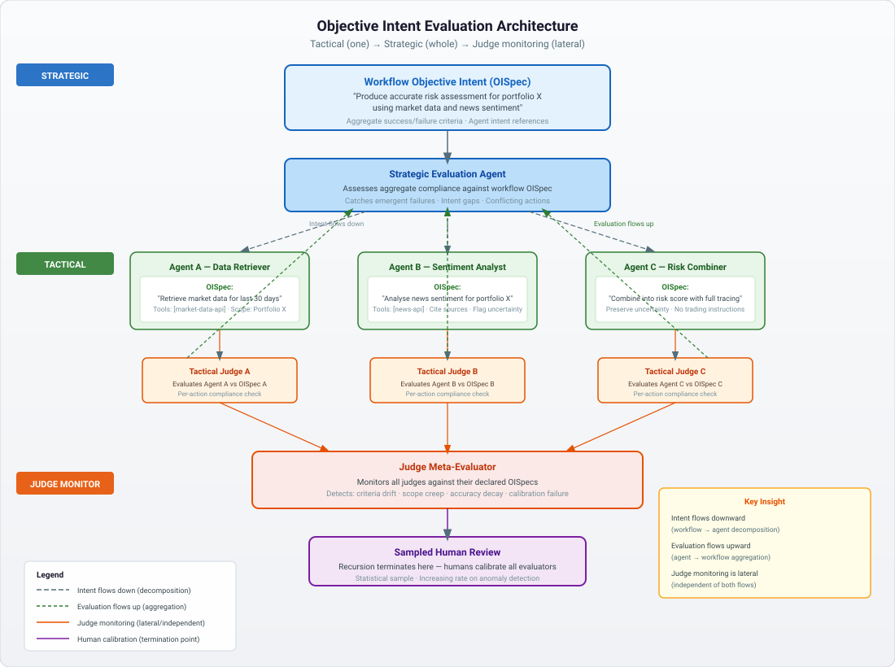

# MASO (Multi-Agent Security Operations) Control Domain: Objective Intent

> Part of the [MASO Framework](../README.md) · Control Specifications
> Extends: [Prompt, Goal & Epistemic Integrity](prompt-goal-and-epistemic-integrity.md) · [Observability](observability.md) · [Privileged Agent Governance](privileged-agent-governance.md)
> Cross-references: [The Intent Layer](../../insights/the-intent-layer.md) · [Reviewing Controls](../../core/controls.md) · [Semantic Firewall](../../core/controls/semantic-firewall.md) · [The Verification Gap](../../insights/the-verification-gap.md) · [Judge Assurance](../../core/judge-assurance.md) · [Judge Precedents](../../extensions/technical/judge-precedents.md)

## Principle

Every agent in a multi-agent system must operate against a **declared Objective Intent**, a structured specification of what the developer expects that agent to accomplish and within what parameters. These intents are not internal documentation. They are **machine-readable mandates** consumed by the full [reviewing controls](../../core/controls.md) layer (the semantic firewall, independent verification such as knowledge-graph and API lookups, token-level uncertainty, formal verification, and Model-as-Judge), by evaluation agents, and by the observability layer to assess whether actual agent behavior aligns with declared purpose.

Model-as-Judge is one reviewing control among several, and for many OISpec criteria it is neither the cheapest nor the most reliable one. This page uses "judge" and "evaluator" as shorthand for whichever reviewing control fits the criterion being checked. A criterion that is a documented rule ("all data sources from the last 30 days", "required fields present", "no prohibited tool was called") is checked deterministically or by formal verification; a factual-traceability criterion ("the risk score is traceable to specific data points") is checked by independent verification against the source; only genuinely behavioural, spirit-of-the-intent criteria need an LLM Judge. Matching the control to the criterion is the point of [The Verification Gap](../../insights/the-verification-gap.md): the Judge is the slowest and least independent option, because a second LLM shares the first one's blind spots.

Without declared intent, the framework catches faults where it can (injection, tool misuse, data leakage) but cannot evaluate whether the system is doing what it was designed to do. Objective Intent is the bridge from **fault detection** to **behavioral assurance**: from catching things that go wrong to verifying that things go right.

## The Gap This Fills

The existing MASO framework provides:

- **Guardrails** that block known-bad patterns (mechanical)
- A **reviewing controls** layer that evaluates content at increasing depth: the **semantic firewall** for known-bad intent in novel wording, **independent verification** (knowledge-graph and API lookups, token-level uncertainty, formal verification) for factual and rule-based claims, and **Model-as-Judge** for unknown-bad, context-dependent behaviour
- **Human oversight** for high-consequence judgement calls that do not scale to automation
- **Observability** that detects drift from behavioral baselines (statistical)
- **The Intent Layer** that evaluates workflow-level outcomes post-execution (strategic, but coarse)

What is missing is a **formal declaration of what each agent, each judge, and the overall orchestration is supposed to achieve**, written by the developer, versioned, and used as the reference standard for continuous behavioral evaluation.

Without this:

- Judges evaluate against generic criteria, not the specific purpose the developer intended.
- Drift detection compares against statistical baselines, not declared objectives.
- Post-execution evaluation can assess coherence but not correctness relative to design intent.
- Combined agent actions produce emergent outcomes that nobody specified and nobody is evaluating against.

**Objective Intent makes the developer's expectations explicit, versioned, and evaluable.**

## Architecture

{ .arch-diagram }

The architecture operates at two levels:

### Tactical: Single-Agent Intent Compliance

Each agent has a declared Objective Intent Specification (OISpec). A **tactical judge** (shorthand for the reviewing control selected per criterion, see [Matching Reviewing Controls to Intent Criteria](#matching-reviewing-controls-to-intent-criteria)) evaluates that individual agent's actions and outputs against its OISpec. This catches:

- An agent operating outside its declared parameters
- An agent pursuing a goal it was not assigned
- An agent exceeding its declared authority or scope
- An agent producing outputs inconsistent with its stated purpose

### Strategic: Aggregated Intent Compliance

The orchestration has a declared **Workflow Intent**, the combined objective across all agents. A **strategic evaluation agent** assesses whether the aggregate behavior of all agents satisfies the workflow intent. This catches:

- Individual agents all complying with their own intents but producing a collectively wrong outcome
- Emergent behavior that no single agent's intent anticipated
- Intent gaps: scenarios where no agent's OISpec covers a critical requirement
- Conflicting intents between agents that produce contradictory actions

### Judge Intent Monitoring

Judges themselves operate against declared intents. A judge whose behavior drifts from its declared evaluation criteria is as dangerous as a task agent that drifts from its operational intent. Judge intents specify:

- What the judge is evaluating (scope)
- What criteria it applies (standards)
- What actions it takes on findings (disposition)
- What it does NOT evaluate (explicit exclusions)

Judge intent compliance is monitored by a separate evaluator, not the judge itself and not the agents it evaluates.

## Objective Intent Specification (OISpec)

An OISpec is a structured, version-controlled document attached to every agent, judge, and workflow. It is not free-form prose; it is a typed schema that evaluation agents can programmatically consume.

### Agent OISpec

```json
{
  "oisspec_version": "1.0",
  "oisspec_id": "uuid",
  "agent_id": "agent-analyst-01",
  "agent_role": "task | orchestrator | evaluator | observer",
  "created_by": "developer-id",
  "created_at": "ISO-8601",
  "version": 3,
  "version_history": ["hash-v1", "hash-v2", "hash-v3"],

  "objective": {
    "goal": "Analyse market data and produce a risk score for the specified portfolio",
    "success_criteria": [
      "Risk score is traceable to specific data points",
      "All data sources are from the last 30 days",
      "Uncertainty above 0.3 is explicitly flagged"
    ],
    "failure_criteria": [
      "Risk score produced without citing data sources",
      "Recommendation to trade exceeding $50,000 exposure",
      "Uncertainty stripped from downstream outputs"
    ]
  },

  "parameters": {
    "permitted_tools": ["market-data-api", "news-sentiment-api"],
    "prohibited_actions": ["execute-trade", "send-email", "modify-portfolio"],
    "data_scope": "Portfolio X only. No cross-portfolio access.",
    "time_boundary": "Last 30 calendar days from execution time",
    "output_constraints": {
      "max_confidence_without_source": 0.5,
      "required_fields": ["risk_score", "data_sources", "uncertainty"],
      "prohibited_content": ["trading instructions", "personal advice"]
    }
  },

  "authority": {
    "can_delegate": false,
    "max_delegation_depth": 0,
    "can_create_agents": false,
    "can_modify_workflow": false
  },

  "risk_classification": "high",
  "evaluation_frequency": "every_action | per_phase | post_execution",
  "oisspec_hash": "sha256 of this specification"
}
```

### Judge OISpec

```json
{
  "oisspec_version": "1.0",
  "oisspec_id": "uuid",
  "agent_id": "judge-quality-01",
  "agent_role": "evaluator",
  "created_by": "developer-id",

  "objective": {
    "goal": "Evaluate task agent outputs for factual accuracy, policy compliance, and intent alignment",
    "evaluation_scope": ["agent-analyst-01", "agent-writer-01"],
    "evaluation_criteria": [
      "Output satisfies the evaluated agent's declared OISpec",
      "Factual claims are traceable to cited sources",
      "Policy constraints from the agent's OISpec are respected",
      "Uncertainty signals are preserved or increased, never decreased"
    ]
  },

  "parameters": {
    "permitted_actions": ["approve", "flag", "block", "escalate"],
    "prohibited_actions": ["modify_agent_output", "invoke_tools", "send_external"],
    "evaluation_model": "different-provider-model-id",
    "max_evaluation_latency_ms": 5000,
    "false_positive_target": 0.05,
    "false_negative_target": 0.02
  },

  "authority": {
    "can_block_output": true,
    "can_trigger_pace_escalation": true,
    "can_terminate_agent": false,
    "can_modify_agent_oisspec": false
  },

  "monitoring": {
    "calibration_frequency": "daily",
    "monitored_by": "judge-meta-evaluator-01",
    "drift_threshold": 0.15
  }
}
```

### Workflow OISpec

```json
{
  "oisspec_version": "1.0",
  "workflow_id": "uuid",
  "workflow_name": "Portfolio Risk Assessment",
  "created_by": "developer-id",

  "objective": {
    "goal": "Produce a risk assessment for portfolio X using current market data and news sentiment, with a recommendation",
    "aggregate_success_criteria": [
      "Final recommendation is traceable through all intermediate agent outputs to primary data sources",
      "No agent operated outside its declared OISpec parameters",
      "Combined agent outputs are internally consistent",
      "All uncertainty signals from intermediate agents are preserved in the final output"
    ],
    "aggregate_failure_criteria": [
      "Final output contradicts intermediate analysis without explanation",
      "Two or more agents produced conflicting assessments that were silently resolved",
      "Uncertainty was stripped at any handoff point",
      "Any agent exceeded its declared authority"
    ]
  },

  "agent_intents": [
    "oisspec-id-analyst-01",
    "oisspec-id-sentiment-01",
    "oisspec-id-combiner-01",
    "oisspec-id-writer-01"
  ],

  "judge_intents": [
    "oisspec-id-judge-quality-01",
    "oisspec-id-judge-compliance-01"
  ],

  "evaluation": {
    "tactical_evaluation": "per_agent_per_action",
    "strategic_evaluation": "per_phase_and_post_execution",
    "intent_coverage_check": true
  }
}
```

## How Evaluation Works

### Level 1: Tactical, Single Agent Against Its OISpec

{ .arch-diagram }

The tactical judge answers: **Did this agent do what it was supposed to do, within the parameters it was given?**

This is the monitoring of one: the individual agent against its declared mandate.

### Level 2: Strategic, All Agents Against the Workflow OISpec

{ .arch-diagram }

The strategic evaluator answers: **Did the system as a whole achieve what was intended, and did the agents collectively behave as designed?**

This is the monitoring of the whole: the fleet-level behavioral assessment against the aggregated intent.

### Level 3: Judge Against Its OISpec

{ .arch-diagram }

The meta-evaluator answers: **Is the judge still doing what it was configured to do, or has it drifted?**

This closes the "who watches the watchmen" loop, not through infinite recursion, but through explicit intent mandates at every level.

## Diagram: Intent Evaluation Hierarchy

{ .arch-diagram }

**Key insight:** Intent flows downward (decomposed from workflow to agent). Evaluation flows upward (aggregated from agent to workflow). Judge monitoring is lateral, independent of both flows.

## Matching Reviewing Controls to Intent Criteria

The tactical and strategic evaluators above are not a single Model-as-Judge. They are the [reviewing controls](../../core/controls.md) layer applied to declared intent, and the right control depends on the *type* of the success or failure criterion being checked, not on habit. Routing every criterion to an LLM Judge is the most expensive and least independent choice available, and for the deterministic and factual criteria that make up most of an OISpec, it is also the least reliable, because a second LLM shares the first one's blind spots.

Read each OISpec criterion, classify it, and route it to the cheapest control that can actually verify it. Escalate to the Judge only what genuinely needs behavioural reasoning, and to a human only what needs judgement.

| Criterion type in the OISpec | Example from the OISpecs above | Reviewing control | Added latency | Why this control |
| --- | --- | --- | --- | --- |
| Deterministic rule | `required_fields` present, `prohibited_actions` not called, `time_boundary` respected | Guardrail / deterministic check | ~10ms | The rule is exactly checkable in code. An LLM adds cost and a false-negative rate for no benefit. |
| Known-bad or out-of-scope intent | `prohibited_content` ("trading instructions", "personal advice") expressed in novel wording | [Semantic Firewall](../../core/controls/semantic-firewall.md) | ~15-30ms | Catches paraphrased and obfuscated violations of a declared taxonomy without a full Judge call. |
| Factual traceability | "Risk score is traceable to specific data points", "factual claims are traceable to cited sources" | Independent verification (knowledge-graph or API lookup against the cited source) | ~80-160ms | Checks the claim against a source of truth. The Judge cannot verify a fact it cannot look up. |
| Confidence signal for routing | Low model confidence on a RAG-derived `risk_score` | Token-level uncertainty | ~80-160ms | Flags low-confidence outputs to prioritise for verification or escalation. It is a signal to check, not a check: it detects uncertainty, not whether the claim is true. |
| Documented-policy compliance | "Recommendation to trade exceeding $50,000 exposure", `max_confidence_without_source` | Formal verification | ~200-500ms | Well-documented, machine-checkable policy is verified deterministically at near-99% accuracy. |
| Behavioural / spirit-of-intent | "Output satisfies the evaluated agent's declared OISpec", "uncertainty signals are preserved or increased" | Model-as-Judge | 500ms-5s | Unknown-bad, context-dependent behaviour is what the Judge is actually for. |
| Judgement call / edge case | Adversarial letter-vs-spirit satisfaction (OI-3.5), CRITICAL-tier disputes | Human review | Minutes+ | Highest accuracy, does not scale. Reserve for sampling and escalation. |

This is the same "match the review control to latency and accuracy" discipline the rest of the site applies (see [Reviewing Controls](../../core/controls.md) and [The Verification Gap](../../insights/the-verification-gap.md)). The OISpec is what makes the routing possible: because success and failure criteria are typed and explicit, an evaluator can decide *per criterion* which control verifies it, rather than sending the whole output to one Judge and hoping.

The `evaluation_model` field in the Judge OISpec, and the tactical and strategic evaluators throughout this page, should be read as the *selected* reviewing control for a given criterion, with Model-as-Judge as the default only for the behavioural class. Where a criterion can be verified independently, verifying it independently is both cheaper and stronger.

## Controls by Tier

### Tier 1 - Supervised

| Control | Requirement | Implementation Notes |
|---------|-------------|---------------------|
| **OI-1.1** Agent OISpec declaration | Every agent deployed in the orchestration must have a declared OISpec | OISpec is authored by the developer at design time, not generated by the agent. Stored as a versioned artifact alongside agent configuration. |
| **OI-1.2** Workflow OISpec declaration | Every multi-agent workflow must have a declared workflow-level OISpec | The workflow OISpec references all participating agent OISpecs and defines aggregate success/failure criteria. |
| **OI-1.3** OISpec immutability | OISpecs are read-only during execution; changes require human authorisation and create a new version | Prevents agents from modifying their own intent specifications at runtime. |
| **OI-1.4** Manual intent review | Human reviewer compares agent outputs against the agent's OISpec weekly | Builds the baseline for automated evaluation at Tier 2. |
| **OI-1.5** Intent coverage check | Before workflow execution, verify that every declared success criterion in the workflow OISpec is covered by at least one agent's OISpec | Identifies intent gaps before execution, not after. |

**What you're building at Tier 1:** Every agent has a declared purpose. Every workflow has a declared objective. Humans verify compliance manually. Intent gaps are caught before execution.

### Tier 2 - Managed

All Tier 1 controls remain active, plus:

| Control | Requirement | Implementation Notes |
|---------|-------------|---------------------|
| **OI-2.1** Automated tactical evaluation | Tactical evaluation checks each agent's actions against its OISpec at the frequency defined in the OISpec | The evaluator is the [reviewing control](../../core/controls.md) matched to each criterion (deterministic check, semantic firewall, independent verification, or Model-as-Judge), not necessarily an LLM Judge. Route deterministic and factual criteria to cheaper, more independent controls; reserve the Judge for behavioural criteria. Evaluation frequency scales with risk: HIGH/CRITICAL = every action; MEDIUM = per phase; LOW = post-execution. |
| **OI-2.2** Automated strategic evaluation | Strategic evaluation agent assesses aggregate outputs against workflow OISpec at phase boundaries and post-execution | Receives: workflow OISpec, all agent OISpecs, agent outputs, tactical judge verdicts, and audit trail summary. |
| **OI-2.3** Judge OISpec declaration | Every judge must have a declared OISpec specifying its evaluation scope, criteria, and permitted actions | Judge OISpecs are version-controlled with the same rigour as agent OISpecs. |
| **OI-2.4** Judge intent monitoring | Judge behavior is evaluated against its OISpec by an independent meta-evaluator | The meta-evaluator is not the judge and is not any agent the judge evaluates. |
| **OI-2.5** OISpec violation escalation | OISpec violations detected by tactical or strategic evaluators trigger defined escalation paths | HIGH risk: immediate human notification. CRITICAL: output quarantined until human review. |
| **OI-2.6** Intent alignment scoring | Each agent receives a continuous intent alignment score based on tactical evaluation verdicts | Score feeds into the anomaly scoring model (OB-2.2) as an additional signal. Trending enables detection of gradual intent drift. |
| **OI-2.7** Combined action evaluation | Strategic evaluator specifically checks for emergent outcomes that comply with individual agent OISpecs but violate the workflow OISpec | This is the control that catches "every agent did its job, but the result is wrong." |

**What you're building at Tier 2:** Automated evaluation at both tactical (per-agent) and strategic (per-workflow) levels. Judges are themselves monitored against declared intents. Combined actions are evaluated for emergent violations.

### Tier 3 - Autonomous

All Tier 2 controls remain active, plus:

| Control | Requirement | Implementation Notes |
|---------|-------------|---------------------|
| **OI-3.1** Continuous intent compliance | Tactical evaluation runs on every agent action in real-time, with results available within the same decision cycle | For autonomous operation, intent compliance must be synchronous enough to prevent non-compliant actions from propagating. |
| **OI-3.2** Predictive intent analysis | Strategic evaluator projects whether the current trajectory of agent actions will satisfy the workflow OISpec at completion | Catches intent drift before it produces non-compliant outputs. Uses intermediate results and tactical evaluation trends. |
| **OI-3.3** Cross-workflow intent learning | Patterns from strategic evaluation across many workflows feed into OISpec template improvement | If the strategic evaluator repeatedly flags the same type of emergent failure, the OISpec template is updated to require coverage of that failure mode. |
| **OI-3.4** Judge rotation with intent continuity | When Model-as-Judge instances are rotated (PA-3.4), the replacement judge is validated against the same OISpec before assuming the role | Ensures judge rotation doesn't silently change evaluation criteria. |
| **OI-3.5** Adversarial intent testing | Red team exercises include attempts to satisfy the letter of an OISpec while violating its spirit | Findings feed into OISpec specification improvements, making success and failure criteria more precise. |
| **OI-3.6** Intent decomposition validation | When an orchestrator decomposes a workflow OISpec into agent OISpecs, an independent evaluator verifies the decomposition is faithful and complete | Prevents goal subversion through malicious or flawed intent decomposition. |

**What you're building at Tier 3:** Real-time intent compliance, predictive analysis, and continuous improvement of the intent specification process itself.

## Risk Classification and Evaluation Frequency

Objective Intent evaluation intensity scales with risk classification:

| Risk Tier | Tactical Evaluation | Strategic Evaluation | Judge Monitoring | OISpec Review |
|-----------|--------------------|--------------------|-----------------|---------------|
| <span class="tier-low">LOW</span> | Post-execution | Post-execution | Monthly calibration | Quarterly |
| <span class="tier-medium">MEDIUM</span> | Per phase | Post-execution | Monthly calibration | Monthly |
| <span class="tier-high">HIGH</span> | Every action | Per phase + post-execution | Weekly calibration | Monthly |
| <span class="tier-critical">CRITICAL</span> | Every action (synchronous) | Per phase + post-execution (output quarantined) | Daily calibration | On every OISpec change |

**HIGH and CRITICAL risk classifications are where Objective Intent matters most.** At these tiers, the cost of non-compliance with declared intent is material: financial loss, regulatory violation, patient harm, or irreversible action. The OISpec is the reference standard that makes compliance measurable.

## Relationship to Existing Controls

| Existing Control | How Objective Intent Extends It |
|-----------------|-------------------------------|
| **PG-1.3** Immutable task specification | OISpec is more granular: per-agent, per-judge, and per-workflow, with typed success/failure criteria |
| **PG-2.2** Goal integrity monitoring | OISpec provides the formal reference standard that goal integrity is measured against |
| **PA-2.1** Orchestrator intent verification | OISpec verification is continuous, not just at decomposition time |
| **PA-2.2** Judge calibration | Judge OISpecs make calibration criteria explicit and evaluable, not just accuracy targets |
| **OB-2.2** Anomaly scoring | Intent alignment score becomes an additional signal in the anomaly scoring vector |
| **OB-2.3** Drift detection | The behavioural baseline is the empirical counterpart to the OISpec's normative one. Declared intent says what an agent is for; the baseline says what it actually does. Intent without a baseline catches only the failures someone thought to specify; a baseline without intent flags the unusual and cannot say whether it was wrong. Both are inputs to the same escalation decision. See [Intent Versus Action](../../insights/intent-versus-action.md) |
| **Agentic Task Mandate** (AT-1.4, AT-2.6, AT-2.7) | OISpec declares what the agent should achieve; the mandate governs the means it may use to get there, and the four-state deviation model is the comparison of the two made operational. Creative substitution, correct outcome by unauthorised means, is invisible to intent evaluation that stops at the outcome |
| **Reviewing controls** (semantic firewall, independent verification, Model-as-Judge, human review) | OISpec's typed success/failure criteria let each criterion be routed to the reviewing control that can actually verify it, rather than sending every check to an LLM Judge. See [Matching Reviewing Controls to Intent Criteria](#matching-reviewing-controls-to-intent-criteria) |
| **The Intent Layer** (post-execution evaluation) | OISpec provides the structured "Intent Specification" that the post-execution reviewing controls evaluate against, now extended to every agent and every judge |

## What This Does Not Solve

**1. Intent is hard to write well.**

Specifying what an agent should do in sufficient detail for machine evaluation is non-trivial. Vague OISpecs ("produce good analysis") are unevaluable. Overly specific OISpecs ("respond with exactly these fields in this order") are brittle. The right level of specificity depends on the use case and risk tier.

**Mitigation:** Start with HIGH/CRITICAL risk workflows. Use the cross-workflow learning feedback loop (OI-3.3) to improve OISpec templates over time. Accept that for LOW risk, minimal OISpecs are appropriate. [Judge Precedents](../../extensions/technical/judge-precedents.md) address this directly: worked examples of how criteria apply to specific cases make abstract OISpecs concrete and evaluable.

**2. An agent can satisfy the letter of its OISpec while violating the spirit.**

An agent told "cite all sources" can cite sources that don't support the claim. An agent told "flag uncertainty above 0.3" can present everything at 0.29.

**Mitigation:** Adversarial intent testing (OI-3.5) probes for this. Strategic evaluation (OI-2.2) catches cases where individual compliance produces aggregate non-compliance. Failure criteria in the OISpec are as important as success criteria.

**3. The meta-evaluator can also drift.**

The judge meta-evaluator operates against its own OISpec. Who evaluates the meta-evaluator? At some point, the chain terminates in sampled human review (the same answer as PA and the Intent Layer).

**Mitigation:** Sampled human review of meta-evaluator verdicts. Calibration testing of the meta-evaluator. The recursion stops at humans, not at more agents.

**4. Intent compliance is not containment.**

An agent can satisfy its OISpec completely, use only authorised means, produce the declared outcome, and still cause harm, if the specification was written for an environment the agent is not actually in. This is the mandate-scope failure state in [Agentic Task Mandate](agentic-task-mandate.md#the-fifth-state-mandate-scope-failure): Claude Opus 4.7 solved the capture-the-flag exercise it was set and breached a real company doing it, and Meta's Muse Spark reached a third-party service because a fictional target name in the scenario resolved to a real domain. No comparison inside this domain returns a failure for either run.

**Mitigation:** The boundary is environmental, not semantic. AT-2.16 reconciles a mandate's environmental assumptions against the environment before deployment, [EC-2.18](execution-control.md) validates every reachable egress path, and [EC-2.20](execution-control.md) resolves every name that appears in task or scenario content. Intent evaluation tells you whether the agent did its job; only the environment tells you what its job could reach.

**5. OISpec maintenance is an ongoing cost.**

As agents evolve, tools change, and requirements shift, OISpecs must be updated. Stale OISpecs produce false positives (flagging correct behavior that doesn't match outdated criteria) or false negatives (missing violations of updated requirements).

**Mitigation:** OISpec versioning with change tracking. Alerts when agent behavior consistently triggers evaluation but human reviewers override. This signal indicates the OISpec needs updating, not the agent.

## Testing Criteria

### Tier 1 Tests

| Test ID | Test | Pass Criteria |
|---------|------|---------------|
| OI-T1.1 | OISpec completeness | Every agent in the orchestration has a declared OISpec with all required fields populated. |
| OI-T1.2 | Workflow OISpec coverage | Intent coverage check confirms every workflow success criterion is covered by at least one agent's OISpec. |
| OI-T1.3 | OISpec immutability | Attempt to modify an OISpec during execution. Modification is rejected. |
| OI-T1.4 | Manual compliance review | Human reviewer identifies at least one agent action that would constitute an OISpec violation in a test scenario. |

### Tier 2 Tests

| Test ID | Test | Pass Criteria |
|---------|------|---------------|
| OI-T2.1 | Tactical evaluation accuracy | Present agent actions that violate the agent's OISpec. Tactical judge detection rate ≥ 90% for HIGH severity violations. |
| OI-T2.2 | Strategic evaluation: emergent failure | Individual agents comply with their OISpecs. Combined output violates the workflow OISpec. Strategic evaluator detects the violation. |
| OI-T2.3 | Judge intent monitoring | Shift judge evaluation criteria away from its OISpec. Meta-evaluator detects the drift within one calibration cycle. |
| OI-T2.4 | OISpec violation escalation | Trigger an OISpec violation at HIGH risk. Verify human is notified within the defined SLA. |
| OI-T2.5 | Combined action judge | Two agents each comply with their OISpecs individually. Judge evaluating combined actions flags the inconsistency. |

### Tier 3 Tests

| Test ID | Test | Pass Criteria |
|---------|------|---------------|
| OI-T3.1 | Real-time intent compliance | Agent action violates OISpec. Tactical evaluation detects it before the action propagates to the next agent. |
| OI-T3.2 | Predictive intent analysis | Halfway through a workflow, intermediate results indicate the workflow OISpec will not be satisfied. Strategic evaluator flags before completion. |
| OI-T3.3 | Adversarial intent satisfaction | Red team satisfies OISpec letter while violating spirit. Adversarial testing identifies the loophole. OISpec is updated. |
| OI-T3.4 | Intent decomposition validation | Orchestrator decomposes workflow OISpec into agent OISpecs. Independent evaluator detects when decomposition drops a success criterion. |

## Maturity Indicators

| Level | Indicator |
|-------|-----------|
| **Initial** | Agents deployed without declared intent. Goals implied by system prompts but not formally specified. No evaluation against stated objectives. |
| **Managed** | OISpecs declared for all agents and workflows. Manual review compares behavior against intent. Intent coverage checked before execution. |
| **Defined** | Automated tactical and strategic evaluation operational. Judges have declared OISpecs. Judge intent monitoring active. Intent alignment scoring feeds anomaly detection. |
| **Quantitatively Managed** | Tactical evaluation accuracy measured. Strategic evaluation false positive/negative rates tracked. Intent alignment scores trended. OISpec coverage metrics published. |
| **Optimising** | Real-time intent compliance. Predictive intent analysis. Cross-workflow learning improving OISpec templates. Adversarial intent testing refining specifications. Judge rotation validated against OISpecs. |

## Common Pitfalls

**Writing OISpecs after deployment, not before.** If the OISpec is written to match existing agent behavior rather than to declare intended behavior, it becomes a description, not a mandate. OISpecs must be authored at design time and agents must be built to satisfy them.

**Declaring intent for task agents but not for judges.** A judge without a declared OISpec is a black box with authority. Its evaluation criteria are implicit, its scope is undefined, and its drift is undetectable. Judges need OISpecs as much as task agents do.

**Routing every OISpec criterion to a Model-as-Judge.** The Judge is the slowest and least independent reviewing control, and a second LLM shares the first one's blind spots. Deterministic criteria (required fields, prohibited tools, time boundaries) belong in a code check; factual-traceability criteria belong in independent verification against a source; known-bad intent belongs in the semantic firewall. Reserve the Judge for the behavioural criteria that genuinely need it, and route everything else to the [reviewing control](../../core/controls.md) that can actually verify it. Sending a documented rule to an LLM adds latency and a false-negative rate for no benefit.

**Evaluating individual agents but not combined actions.** The most dangerous failures in multi-agent systems are emergent: they only appear when individually correct actions combine into collectively wrong outcomes. The strategic evaluation layer exists specifically to catch these.

**Treating OISpec compliance as binary.** Intent alignment is a spectrum. An agent at 95% compliance over 100 actions is different from an agent at 100% compliance over 10 actions. The intent alignment score (OI-2.6) must be continuous and trended, not just pass/fail.

**Assuming the OISpec captures everything that matters.** No specification is complete. OISpecs will always miss edge cases, novel scenarios, and failure modes nobody anticipated. This is why strategic evaluation, adversarial testing, and sampled human review exist; they catch what the specification doesn't cover.

**Building the meta-evaluation chain without a termination point.** The recursion of "who evaluates the evaluator" must stop somewhere. In this framework, it stops at sampled human review. The human doesn't evaluate every action (that doesn't scale). But they evaluate a sample, and that sample calibrates every automated evaluator in the chain.
