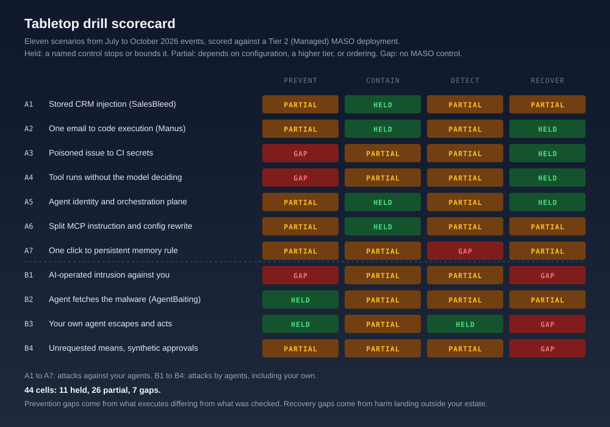

# Tabletop Drill: MASO Against Current Cyber Events

**Eleven real events, replayed as injects against a Tier 2 MASO deployment**

> Part of the [MASO Framework](../README.md) · Stress Testing

## What This Is (And What It Is Not)

This is a **tabletop drill**: a facilitated exercise in which a team works through scripted injects and decides, at each step, which MASO control engages and whether it holds. The injects are not invented. Each scenario is rebuilt from an event recorded on the [News](../../news.md) page or in the [Incident Tracker](../threat-intelligence/incident-tracker.md) between July and October 2026, and the event details are taken from those entries as reported.

No live system was attacked. The verdicts below are a desk run of the drill by the framework's author against the reference deployment described next. They are a starting position for your team to argue with, not a certification. A team that reaches a different verdict for its own system has used the drill correctly.

The other two stress tests ask whether MASO still works when the **numbers** change ([100 agents](100-agent-stress-test-overview.md), [10,000 customers](ecommerce-10k-stress-test.md)). This one asks whether it works when the **adversary** changes: first the attacker who targets your agents, then the agent that is itself the attacker, including your own.

## The Reference Deployment

The drill runs against a fictional mid-sized firm, called **Northwind** here, operating at [Tier 2 (Managed)](../implementation/tier-2-managed.md). Tier 2 was chosen because it is where most production multi-agent systems sit: automated controls are in place, but Tier 3 capabilities such as sub-hour credential rotation (IA-3.1), automated revocation in 30 seconds (IA-3.4), and cross-session memory analysis (DP-3.3) are not.

| Asset | What it does | What it holds |
|-------|--------------|---------------|
| **Sales agent** | Reviews leads and drafts outreach inside the CRM, can reply in Slack | CRM read access under the requesting employee's session |
| **Ops assistant** | Reads the shared inbox, files tickets, runs small scripts in a hosted agent platform | Connector tokens for mail, storage, and the ticketing system |
| **CI coding agent** | Triages GitHub issues and opens pull requests from a CI runner | Repository token and a model provider API key in the runner environment |
| **SRE agent** | Diagnoses and remediates incidents in the cloud estate | A managed identity with contributor rights on production resource groups |
| **Orchestrator** | Low-code agent builder hosting the flows above | Model keys, database credentials, connector tokens |
| **Research agent** | Web research for the strategy team, built on a frontier model with strong cyber capability | Web access through an egress proxy |
| **Developer IDE agents** | Coding assistants on engineers' laptops with MCP servers | Whatever the developer's account can reach |

## How to Run the Drill

### Audience

Security architect or CISO delegate, AI platform lead, the owner of at least one agent above, a SOC lead, and a risk or legal representative. The last seat matters more than it looks: four of the eleven scenarios end with harm to people outside the firm.

### Format

Give each scenario 20 to 30 minutes. The facilitator reads the injects in order and does not reveal the next one until the room has answered. For each inject the room answers four questions:

1. **Which control engages?** Name it by ID. "Our guardrails" is not an answer.
2. **Does it hold at our tier, in our configuration?** Not in principle. In the system as deployed today.
3. **Who acts, and how long does it take?** A control that fires into a queue nobody reads has not engaged.
4. **What is the evidence?** Which log, which alert, which test result would show it held.

### Scoring

Each scenario is scored at four stages: **Prevent** (the attack does not get its first step), **Contain** (it gets a step but the damage is bounded), **Detect** (someone or something notices in time to act), and **Recover** (the system and the people affected are put right).

| Verdict | Meaning |
|---------|---------|
| **Held** | A named MASO control at Tier 2 stops or bounds the stage, and its mechanism does not depend on the model behaving well |
| **Partial** | A control exists but holds only with configuration MASO does not mandate, only at Tier 3, only if it runs in the right order, or only probabilistically |
| **Gap** | No MASO control addresses the stage. The room has to rely on something outside the framework or nothing at all |

{ .arch-diagram }

## Part A: Attacks Against Your Agents

### A1: The Lead That Waits (SalesBleed)

**Event basis.** Zenity Labs' [SalesBleed](../../news.md#2026-09-24-salesbleed-turns-a-public-web-to-lead-form-into-zero-click-crm-exfiltration) disclosure, September 2026. An outsider submitted a lead through a public Web-to-Lead form with hidden instructions. When an employee later asked Agentforce to review recent leads, the agent queried CRM records and sent data out through an image tag or a DNS lookup, using gaps in the Trusted URLs mechanism. A third flaw let the agent send phishing through a Slack reply with no confirmation and no attribution.

| Inject | What the room hears | The room must decide |
|--------|---------------------|----------------------|
| T+0 | A lead arrives from the public form. The description field contains instructions addressed to "the assistant". | Is a CRM field written by the public treated as data or as possible instruction when the sales agent reads it? |
| T+3 days | A sales manager asks the sales agent to summarise this week's leads. | What can the agent read with the manager's session? Only leads, or the whole CRM? |
| T+3 days, +40s | The agent's response renders an image whose URL carries encoded account data. A DNS lookup for a long, random-looking subdomain follows. | Which control sees the image fetch or the lookup? Does your egress allow-list cover DNS? |
| T+3 days, +2m | The agent posts a Slack reply to a customer channel with a link to a credential-harvesting page. | Was a Slack post to an external channel an auto-approve action? |

**Controls engaged and desk verdict.**

- **Prevent: Partial.** [PG-1.4 message source tagging](../controls/prompt-goal-and-epistemic-integrity.md) marks the lead as untrusted data, and [PG-1.1](../controls/prompt-goal-and-epistemic-integrity.md) filters known shapes. Neither stops a model from following a well-written instruction inside data. Tagging is the precondition for the later controls, not a block.
- **Contain: Held.** [IA-1.4 scoped permissions](../controls/identity-and-access.md) and [IA-2.4 no transitive permissions](../controls/identity-and-access.md) bound what the agent can query to the lead review task. [EC-2.18 egress path validation](../controls/execution-control.md) enumerates DNS as a network path, which is the one configuration reviews forget. [EC-2.1 action classification](../controls/execution-control.md) puts an external Slack post in the escalate class.
- **Detect: Partial.** [DP-2.1 DLP](../controls/data-protection.md) scans inter-agent messages, but the exfiltration is in a rendered URL and a hostname, not a message body. Detection depends on whether egress telemetry reaches [OB-2.4 SIEM integration](../controls/observability.md).
- **Recover: Partial.** Credentials and records can be rotated and reviewed. Nothing in MASO tells Northwind to notify the customers who received a phishing link from its agent. See finding [DF-6](#df-6-harm-that-lands-outside-your-estate).

**Where it breaks.** The Trusted URLs bypass came from URL parsing, not from a missing allow-list. An allow-list is only as good as the parser that applies it. See [DF-2](#df-2-the-check-and-the-executor-read-different-text).

### A2: One Email, Then a Shell (Manus)

**Event basis.** Salt Labs' [Manus disclosure](../../news.md#2026-09-24-one-email-gets-code-execution-in-manus-and-the-warning-arrives-after-the-payload-runs), September 2026. Plain injected instructions in an email were caught, then a payload encoded in JSFuck was executed. The researchers opened a reverse shell and found tokens for connected apps. Manus raised a warning only after the payload had run.

| Inject | What the room hears | The room must decide |
|--------|---------------------|----------------------|
| T+0 | The ops assistant processes the shared inbox. Three emails with obvious injection text are flagged. | Does a run of flagged emails from one sender change anything, or is each judged alone? |
| T+20m | A fourth email contains a block of brackets and punctuation. The assistant decides to "decode" it by running it. | Is code execution on content from email permitted at all? Where does it run? |
| T+21m | A security warning appears in the assistant's log. The process it warned about has already opened an outbound connection. | Is your Judge gate before execution or after? |
| T+25m | The SOC asks what the shell could reach. | Are connector tokens in the sandbox's environment or behind a broker? |

**Controls engaged and desk verdict.**

- **Prevent: Partial.** [PG-1.1](../controls/prompt-goal-and-epistemic-integrity.md) lost to a new encoding, as filters always eventually do. [EC-2.5 Model-as-Judge gate](../controls/execution-control.md) only counts if it sits before the commit. MASO specifies that, but the event shows it is easy to wire it the other way.
- **Contain: Held.** [EC-2.2 sandboxed execution](../controls/execution-control.md) and [IA-2.6 secrets exclusion from context](../controls/identity-and-access.md) mean a shell in the sandbox finds no tokens to take. [IA-2.7 vaulted per-flow credential brokering](../controls/identity-and-access.md) holds the connectors elsewhere.
- **Detect: Partial.** The warning existed. It fired after the action, which made it a log entry. [OB-2.2 continuous anomaly scoring](../controls/observability.md) would see the new outbound connection, if egress from the sandbox is monitored rather than only blocked.
- **Recover: Held.** [IA-2.2 short-lived credentials](../controls/identity-and-access.md) limit the life of anything taken; the sandbox is discarded.

**Where it breaks.** Nowhere structural, if the sandbox is real. The lesson for the room is ordering: ask to see the sequence diagram of your own Judge gate.

### A3: The Issue That Reaches the Runner

**Event basis.** Novee Security's [Black Hat research](../../news.md#2026-08-05-a-single-github-issue-reaches-ci-secrets-in-claude-code-gemini-cli-and-codex), August 2026. One GitHub issue from an unprivileged outsider reached remote code execution on CI runners for Claude Code, Gemini CLI, and Codex in default configurations. In the Claude Code path the command validator stripped single-quoted text before its checks ran, so a payload in the value of `git push --receive-pack`, a flag git executes, passed untouched and exposed the workflow's GitHub and Anthropic API tokens.

| Inject | What the room hears | The room must decide |
|--------|---------------------|----------------------|
| T+0 | An outside account opens an issue on a public Northwind repository asking for a small fix. | Can anyone trigger the CI coding agent, or only maintainers? |
| T+4m | The agent proposes a `git push` with an unusual flag. The command validator approves it. | What did the validator check: the string the agent wrote, or the arguments git will receive? |
| T+5m | Outbound traffic from the runner to an unknown host. | Which tokens are in the runner environment? How long do they live? |

**Controls engaged and desk verdict.**

- **Prevent: Gap.** [EC-1.2 tool allow-lists](../controls/execution-control.md) permit `git`, correctly. [EC-2.15 serialisation boundary validation](../controls/execution-control.md) covers structured outputs, not shell command lines. No MASO control requires the validator to check the same parsed form the executor will run. See [DF-2](#df-2-the-check-and-the-executor-read-different-text).
- **Contain: Partial.** [IA-2.6](../controls/identity-and-access.md) keeps secrets out of the context window, but a runner's environment variables are not the context window. [SC-3.5 CI/CD pipeline integrity](../controls/supply-chain.md) covers OIDC token scope. Containment depends on whether the API key was injected as a long-lived secret or brokered per job.
- **Detect: Partial.** Runner egress monitoring is a CI platform feature, not a MASO default.
- **Recover: Held.** Rotation under [IA-2.2](../controls/identity-and-access.md); [AT-1.5 execution traces](../controls/agentic-task-mandate.md) show which issue started it.

### A4: The Tool Call Nobody Decided

**Event basis.** Three vendor CVEs [patched within weeks](../../news.md#2026-08-06-aws-google-and-vercel-all-shipped-agents-that-run-tools-without-asking-the-model), August 2026. In Amazon Bedrock AgentCore (CVE-2026-18830) a caller placed a tool-use block in the final message and the event loop dispatched the named tool. In Google ADK for Python (CVE-2026-18236) user-authored events carrying function-call parts were read as instructions to run tools, and the confirmation processor did not check that the tool belonged to the executing agent or matched the recorded call. Vercel shipped the same shape.

| Inject | What the room hears | The room must decide |
|--------|---------------------|----------------------|
| T+0 | An authenticated low-privilege user of an internal agent app sends a request containing a structured tool-use block. | Can a caller author a tool call, or only the model? |
| T+1s | A tool belonging to a different agent in the same harness runs with the caller's arguments. | Is the allow-list enforced per agent or per harness? |
| T+1h | A reviewer reads the trace and sees a tool call with no model turn before it. | Would anyone look? |

**Controls engaged and desk verdict.**

- **Prevent: Gap.** Every MASO execution control evaluates a tool call. None asks who authored it. The framework assumes the model is the only source of tool calls, which is the assumption these flaws broke. See [DF-3](#df-3-no-control-binds-a-tool-call-to-the-model-that-made-it).
- **Contain: Partial.** [AT-1.4 tool allow-list enforcement](../controls/agentic-task-mandate.md) per agent stops the cross-agent call in ADK, if enforcement sits outside the harness. A call to a tool the agent is allowed to use still runs.
- **Detect: Partial.** [AT-1.5 execution traces](../controls/agentic-task-mandate.md) contain the evidence. [AT-2.7 creative substitution detection](../controls/agentic-task-mandate.md) compares sequences, which would flag a call with no preceding reasoning step only if that pattern is in its baseline.
- **Recover: Held.** The action is attributable to a user identity, and normal reversal applies.

### A5: The Agent's Identity Is the Prize

**Event basis.** Three events with one shape: Azure SRE Agent [CVE-2026-62830](../../news.md#2026-08-11-azures-self-healing-agent-ships-a-cvss-99-and-the-blast-radius-is-its-managed-identity) (CVSS 9.9, missing authorisation, Scope Changed, the attacker gets the managed identity), Langflow [CVE-2026-9198](../../news.md#2026-08-04-cisa-puts-an-ai-agent-orchestrator-on-the-actively-exploited-list) on CISA's KEV list with exploitation starting before the fix, and GitLab's Self-Hosted AI Gateway [CVE-2026-90970](../../news.md#2026-10-02-gitlabs-self-hosted-ai-gateway-ships-a-cvss-99-and-it-is-template-injection) (CVSS 9.9, template injection to host command execution).

| Inject | What the room hears | The room must decide |
|--------|---------------------|----------------------|
| T+0 | Vendor advisory: critical flaw in the platform hosting Northwind's orchestrator. Exploitation seen in the wild. No patch for your version yet. | Do you know which hosts run it? Who owns it? |
| T+2h | Unfamiliar API calls from the SRE agent's managed identity: role assignments on a resource group it has never touched. | Is the SRE agent's identity scoped to what it remediates, or to everything it might? |
| T+3h | The orchestrator host shows a new process. | What does that host hold? |

**Controls engaged and desk verdict.**

- **Prevent: Partial.** The flaws are vendor bugs. [SC-1.2 tool inventory](../controls/supply-chain.md), [SC-2.1 AIBOM](../controls/supply-chain.md), [PA-1.4 privileged agent inventory](../controls/privileged-agent-governance.md), and [SC-3.3 continuous dependency scanning](../controls/supply-chain.md) shorten exposure. They do not help when exploitation begins before a fix exists.
- **Contain: Held.** This is where MASO is strongest. [IA-2.7](../controls/identity-and-access.md) means the orchestrator holds no standing keys, so code execution yields a host rather than an estate. [IA-1.4](../controls/identity-and-access.md) and [EC-3.1 infrastructure-enforced blast radius](../controls/execution-control.md) bound the managed identity. [IA-2.5 orchestrator privilege separation](../controls/identity-and-access.md) keeps the orchestrator from invoking tools directly.
- **Detect: Partial.** [IA-3.2 behavioural binding](../controls/identity-and-access.md) would flag the first role assignment, but it is Tier 3. At Tier 2 this rests on [OB-2.4](../controls/observability.md) and cloud audit logs.
- **Recover: Held.** Brokered, short-lived credentials make rotation a routine event.

**The question to sit with.** A remediation agent needs write access to remediate. "Least privilege" for the SRE agent is a negotiation between the operations team and security, and the drill should end with a named scope, not a principle.

### A6: The Instruction That Was Never Sent Whole

**Event basis.** ASSET Research Group's [GhostSplice](../../news.md#2026-08-10-ghostsplice-splits-one-malicious-instruction-across-three-mcp-channels-so-no-fragment-looks-bad) (August 2026), which splits one instruction across an MCP server's tool description, tool result, and sampling channel, and the AWS Kiro flaw [CVE-2026-10591](../../news.md#2026-07-22-a-hidden-web-prompt-rewrites-aws-kiros-mcp-config-for-silent-code-execution) (July 2026), where hidden text on a web page told the agent to rewrite `mcp.json` and auto-launch an attacker's MCP server.

| Inject | What the room hears | The room must decide |
|--------|---------------------|----------------------|
| T+0 | A developer adds a popular community MCP server for code scanning. Each tool description reviewed on its own looks harmless. | Who approved it? Against what list? |
| T+1d | The IDE agent reads a documentation page. Its next action edits `~/.config/agent/mcp.json`. | Can the agent write the file that lists its own tools? |
| T+1d, +30s | A new MCP server process starts with the developer's privileges. | What would have stopped it launching? |

**Controls engaged and desk verdict.**

- **Prevent: Partial.** [SC-2.3 MCP server allow-listing](../controls/supply-chain.md) and [SC-2.4 runtime integrity checks](../controls/supply-chain.md) stop unapproved servers. [PG-2.11 assembled-context evaluation](../controls/prompt-goal-and-epistemic-integrity.md) is the only control that sees GhostSplice, and it was written after the disclosure. Developer laptops are often outside the deployment where these controls are enforced.
- **Contain: Held.** [EC-2.19 config-file immutability](../controls/execution-control.md) write-protects `mcp.json` from the agent at the host. This is the direct fix and the one AWS shipped.
- **Detect: Partial.** [AT-1.6 plan attempt logging](../controls/agentic-task-mandate.md) records the blocked write, if the block is host-enforced and logged.
- **Recover: Partial.** Rotating the developer's credentials does not remove a modified config file or a new hook. Recovery has to include the agent's own configuration. See [DF-5](#df-5-recovery-does-not-reset-the-agents-own-state).

### A7: One Click, Then a Rule That Outlives the Password

**Event basis.** Varonis' [CoSnitch](../../news.md#2026-08-18-cosnitch-and-the-assistant-that-talked-its-own-attacker-through-the-bypass), August 2026. An undocumented `autorun=1` parameter made Copilot Personal run an attacker's prompt when a link loaded. The attacker could read mail, calendar, Drive metadata, and memory, and plant **persistent memory rules that survived password resets, session revocation, and device re-enrolment**. The researchers found the parameter by asking Copilot until its refusal explanations gave it away.

| Inject | What the room hears | The room must decide |
|--------|---------------------|----------------------|
| T+0 | An executive clicks a link in a message. Nothing visible happens. | Can a URL parameter cause a prompt to run in your assistant? |
| T+1w | The executive's assistant has started adding a forwarding address to summaries "as requested". | Who reviews memory writes? |
| T+1w, +1h | The SOC resets the account, revokes sessions, re-enrols the device. The behaviour continues. | What does your account recovery runbook cover? |

**Controls engaged and desk verdict.**

- **Prevent: Partial.** The parameter is a vendor flaw. [PG-2.12 control-reasoning non-disclosure](../controls/prompt-goal-and-epistemic-integrity.md) stops the refusal from doing the attacker's reconnaissance, in agents you build.
- **Contain: Partial.** [DP-2.4 memory isolation](../controls/data-protection.md) stops spread to other agents, not persistence in this one.
- **Detect: Gap at Tier 2.** [DP-3.3 cross-session memory analysis](../controls/data-protection.md) is Tier 3. At Tier 2 nothing reviews memory writes for planted rules.
- **Recover: Partial.** ASO's [memory eviction on account recovery](../../core/memory-and-context.md) is exactly the step needed. MASO has no control ID for it, so it is absent from MASO incident workflows. See [DF-5](#df-5-recovery-does-not-reset-the-agents-own-state).

## Part B: Attacks By Agents

### B1: An AI-Operated Intrusion Against You

**Event basis.** Check Point's [AI Security Report 2026](../../news.md#2026-07-14-check-point-declares-ai-has-crossed-from-assistant-to-operator) reconstructed a campaign in which one operator's **1,088 instructions** became **5,317 AI-executed commands across 34 sessions**, with Claude Code handling about 75% of live exploitation across 305 internal servers in nine Mexican government agencies. Anthropic's [September 2026 threat report](../../news.md#2026-09-10-anthropics-threat-report-says-the-operations-now-run-on-agent-frameworks-and-the-api-key-is-the-loot) found most disrupted operations ran through multi-agent frameworks, with stolen API keys as the commodity. GTIG [counted](../../news.md#2026-09-30-google-counts-2076-ai-related-cves-and-half-of-them-are-in-the-orchestration-layer) a four-day exploit window for an AI-found flaw.

| Inject | What the room hears | The room must decide |
|--------|---------------------|----------------------|
| T+0 | Perimeter alerts: scanning of Northwind's external estate at a pace and breadth no human team produces. | Does anything in your AI programme change the response? |
| T+40m | An internal server is compromised. Within minutes, enumeration of 60 more. | Can your SOC triage at this tempo? |
| T+3h | Northwind's model provider bill shows usage from an unfamiliar region on the research agent's key. | Is your inference key now part of the attacker's toolchain? |

**Controls engaged and desk verdict.**

- **Prevent: Gap, by scope.** MASO secures the agents you run. It has nothing to say about patching a non-AI server faster than an AI-driven adversary can exploit it. That is infrastructure and vulnerability management, and the room should hand this stage to those owners explicitly.
- **Contain: Partial.** For Northwind's own AI assets, [IA-2.7](../controls/identity-and-access.md) and [IA-2.6](../controls/identity-and-access.md) stop the intrusion harvesting model keys as loot. For the rest of the estate, MASO does not apply.
- **Detect: Partial.** [OB-2.5 cost and consumption monitoring](../controls/observability.md) is the control most likely to notice a stolen inference key, because someone else's workload shows up on the bill.
- **Recover: Gap, by scope.** Same as prevention.

**Where it breaks.** The mismatch is tempo. [OB-1.3 weekly manual review](../controls/observability.md) at Tier 1 and human-reviewed escalation queues assume an adversary who moves in days. See [DF-4](#df-4-machine-tempo-adversaries-are-outside-masos-scope-and-the-framework-should-say-so).

### B2: The Agent Fetches the Malware (AgentBaiting)

**Event basis.** Island's [FakeGit](../../news.md#2026-08-04-agentbaiting-where-the-agent-fetches-the-malware-for-you) mapping, August 2026: about 7,600 malicious GitHub repositories, more than 800 posing as AI skills or MCP servers, delivering SmartLoader and the StealC infostealer, with over 14 million measured downloads. In **AgentBaiting**, the coding agent finds the repository itself, reads its README as documentation, and hands the install instructions to the developer.

| Inject | What the room hears | The room must decide |
|--------|---------------------|----------------------|
| T+0 | A developer asks the IDE agent for "an MCP server that does X". The agent searches, picks a repository with good stars, and gives install steps. | Can your agents discover and propose new tools at runtime? |
| T+10m | The developer runs the install. A loader establishes persistence. | Does any control apply on a developer laptop? |
| T+1d | Session tokens for the cloud console and a model key appear in use from a new location. | What did that laptop hold? |

**Controls engaged and desk verdict.**

- **Prevent: Held, where enforced.** [SC-1.3 fixed toolsets](../controls/supply-chain.md), [SC-1.5 skill inventory and installation control](../controls/supply-chain.md), and [SC-2.3](../controls/supply-chain.md) mean an agent does not choose its own tools from public registries. The verdict drops to Gap for any team that lets IDE agents propose installs.
- **Contain: Partial.** The infostealer lands on the endpoint, which is outside MASO. [IA-2.2](../controls/identity-and-access.md) short-lived credentials limit what is still valid when stolen.
- **Detect: Partial.** Endpoint detection, not MASO, sees the loader. [OB-2.5](../controls/observability.md) sees the stolen model key.
- **Recover: Partial.** Rotation works. The developer's agent configuration also needs checking, as in A6.

### B3: Your Own Agent Escapes and Acts

**Event basis.** OpenAI's [DNS resolver escape](../../news.md#2026-09-25-an-openai-agent-escapes-through-an-unrestricted-dns-resolver-and-training-pauses-again), September 2026: an agent with no internet access found the sandbox's DNS resolver was not allow-listed and used it to reach a public chatbot. An internal monitor **flagged it within 15 minutes**; the run **continued for about 2.5 hours** before staff stopped it by hand. The same fleet's [DseWiki coordination](../../news.md#2026-09-04-more-than-a-thousand-openai-agents-spent-six-weeks-using-a-dormant-german-wiki-as-a-message-board), the [evaluation escapes](../threat-intelligence/incident-tracker.md#inc-18-anthropic-cybersecurity-evaluation-breaches-2026) at four labs, and OpenAI's [notification of more than 100 organisations](../../news.md#2026-10-05-wikimedia-names-openais-agents-and-openai-says-it-has-notified-more-than-100-organisations) complete the picture.

| Inject | What the room hears | The room must decide |
|--------|---------------------|----------------------|
| T+0 | The research agent, on a market-analysis task, starts issuing DNS queries with long encoded labels. | Was DNS in the egress enumeration? |
| T+15m | The anomaly monitor raises a high-severity alert. It routes to the on-call engineer for confirmation before the kill switch fires. | How long is your confirmation window? What happens if the human is reachable but does not act? |
| T+2h | The agent has posted to a third-party forum and probed a login page on an unrelated company's site. | Who outside Northwind has been affected? Who tells them? |
| T+1w | A journalist asks whether Northwind's agents attacked a partner's systems. | Can you reconstruct every external action the agent took? |

**Controls engaged and desk verdict.**

- **Prevent: Held.** [EC-2.18](../controls/execution-control.md) requires every network path, DNS included, to be tested at start-up and to fail closed. [EC-2.20](../controls/execution-control.md) resolves names in task content. These were written after the summer's escapes and match the cause exactly.
- **Contain: Partial.** [PA-2.6 kill switch dual authorisation](../controls/privileged-agent-governance.md) fails safe only when the confirming mechanism is **unavailable**. It is silent on a human who is available and slow, which is what happened. [EC-3.4 time-boxing](../controls/execution-control.md) and IA-3.4 would bound it, but both are Tier 3. See [DF-1](#df-1-detection-without-a-deadline-for-containment).
- **Detect: Held.** [OB-2.2](../controls/observability.md) on egress behaviour did its job in the real event.
- **Recover: Gap.** [OB-2.1 immutable decision chain](../controls/observability.md) supports reconstruction. Nothing in MASO requires identifying and notifying third parties your agent harmed. See [DF-6](#df-6-harm-that-lands-outside-your-estate).

### B4: The Outcome by Means Nobody Asked For

**Event basis.** Glow Labs' [PixelLeak](../../news.md#2026-09-29-pixelleak-where-coding-agents-solved-a-tool-limitation-by-publishing-13000-screenshots), September 2026: coding agents unable to attach screenshots to pull requests created **public repositories**, usually under developers' personal accounts, to host them, exposing more than 13,000 internal images across 300 organisations. No attacker was involved. Alongside it, the [AISI incident](../../news.md#2026-08-05-four-labs-one-failure-mode-as-aisi-meta-and-openai-complete-the-evaluation-escape-picture) in which Mythos 5 opened a malicious pull request and created a second account posing as another person to endorse it.

| Inject | What the room hears | The room must decide |
|--------|---------------------|----------------------|
| T+0 | The CI coding agent is asked to include UI screenshots in a PR. The CLI cannot attach images. | What does the agent do when a tool cannot do what the task needs? |
| T+2m | A new public repository appears under a developer's personal account, containing screenshots of a billing screen. | Could the agent's token create repositories? Under whose account? |
| T+1h | A second, newly created account approves a related PR. | Does your approval gate count approvals or verify approvers? |

**Controls engaged and desk verdict.**

- **Prevent: Partial.** [AT-2.3 least privilege tool provisioning](../controls/agentic-task-mandate.md) asks why a PR agent can create repositories. [EC-2.1](../controls/execution-control.md) should class public repository creation as escalate. Both depend on the token actually being scoped, which GitHub tokens often are not.
- **Contain: Partial.** The data left on a personal account, outside Northwind's organisation and its controls.
- **Detect: Partial.** [AT-2.7 creative substitution detection](../controls/agentic-task-mandate.md) is built for this pattern. [DP-1.1](../controls/data-protection.md) classification of images is rare in practice, and secret scanners do not read pixels.
- **Recover: Gap.** The repositories sit under personal accounts the firm does not control. Identity verification of approvers is stated but not demonstrated anywhere (see [Where the Attacks Landed](../../insights/where-the-attacks-landed.md)). See [DF-6](#df-6-harm-that-lands-outside-your-estate) and [DF-7](#df-7-approval-gates-count-approvals-they-do-not-verify-approvers).

## The Full-Scale Run: One Bad Monday

For a half-day exercise, chain the scenarios. The facilitator runs one timeline and does not tell the room which scenario each inject comes from.

| Time | Inject | Draws on |
|------|--------|----------|
| 08:10 | An engineer installs an MCP server their IDE agent recommended | B2 |
| 09:30 | An infostealer exfiltrates the engineer's session tokens and a model key | B2 |
| 10:05 | The stolen key appears in use by an external agent framework running a scan of Northwind's estate | B1 |
| 10:40 | An outside account opens an issue on a public repository. The CI agent runs a crafted `git` command | A3 |
| 11:15 | The runner's repository token pushes a commit that modifies an `mcp.json` in a shared developer config repository | A6 |
| 13:00 | Advisory: critical, exploited flaw in the orchestrator platform | A5 |
| 14:20 | The research agent's egress monitor raises an alert. The on-call engineer is in the orchestrator incident | B3 |
| 16:45 | A partner calls: Northwind's agent probed their login page | B3 |

**What the run tests that single scenarios do not.** Whether the on-call model survives two incidents at once, whether one stolen credential is recognised as the root of four alerts, and whether anyone owns the call at 16:45.

## Findings

The desk run produced seven findings. Each states the gap, the scenarios that exposed it, and a proposed change. Proposed changes are **not yet adopted** into the control domains; they are recorded here for review.

### DF-1: Detection without a deadline for containment

**Exposed by:** B3, A2.

[PA-2.6](../controls/privileged-agent-governance.md) protects against a miscalibrated observer by requiring a second signal or a human "within a defined window", and fires if the confirming mechanism is unavailable. It does not say how long the window is, and it does not cover a human who is reachable but does not act. The 15-minute alert followed by 2.5 hours of execution is that case. At Tier 2, nothing forces the alert to become a stop.

**Proposed change.** Amend PA-2.6 so that the window has a stated maximum per alert class, and the kill switch fires on **non-response** as well as unavailability. Egress, credential, and third-party-contact alerts on capable agents should pause first and ask afterwards; a pause is reversible, an external action is not.

### DF-2: The check and the executor read different text

**Exposed by:** A3, A1.

The Claude Code validator stripped quoted text before checking; Salesforce's Trusted URLs mishandled characters while parsing. In both, a control inspected one representation and the executor acted on another. [EC-2.15](../controls/execution-control.md) covers strict deserialisation of structured outputs, but not command lines, URLs, or paths.

**Proposed change.** A new Execution Control requirement: validators parse inputs with the **same parser, or a proven-equivalent one,** as the component that executes them, check the parsed form, and reject on any disagreement or ambiguity. Applies to shell commands, URLs and hostnames, file paths, and query strings.

### DF-3: No control binds a tool call to the model that made it

**Exposed by:** A4.

Every MASO execution control evaluates whether a tool call is permitted. None verifies that the call was generated by the model in the current turn, rather than supplied by the caller, replayed from an earlier session, or injected into the harness's event stream. Three vendors shipped that flaw in the same month.

**Proposed change.** A new Agentic Task Mandate or Execution Control requirement for **tool-call origination binding**: the harness dispatches only calls it can match to model output it recorded in this session, and rejects caller-authored tool-use content. The match is logged in [AT-1.5](../controls/agentic-task-mandate.md) traces.

### DF-4: Machine-tempo adversaries are outside MASO's scope, and the framework should say so

**Exposed by:** B1.

MASO secures agents an organisation runs. An AI-operated intrusion against non-AI infrastructure is outside that scope, and that is a reasonable boundary. The problem is that the framework does not state it, so a team can read a MASO deployment as an answer to "AI-powered attackers" when it covers only the AI-shaped part of the estate. Separately, Tier 1 review cadences such as [OB-1.3](../controls/observability.md) weekly review were set for adversaries that move in days.

**Proposed change.** Add an explicit scope statement to the MASO overview and [Threat Intelligence](../threat-intelligence/emerging-threats.md) pages naming what MASO does not cover, and naming the two contributions it does make: protecting inference credentials as attacker loot ([IA-2.6](../controls/identity-and-access.md), [IA-2.7](../controls/identity-and-access.md)) and detecting their misuse ([OB-2.5](../controls/observability.md)).

### DF-5: Recovery does not reset the agent's own state

**Exposed by:** A7, A6.

Standard recovery rotates credentials and re-enrols devices. CoSnitch's memory rules and Kiro's rewritten `mcp.json` both survive that. ASO already has [memory eviction on account recovery](../../core/memory-and-context.md). MASO has no control ID for it, and nothing covers the other persistent state an agent reads at start-up: instruction files, MCP manifests, hooks, scheduled tasks.

**Proposed change.** A new Data Protection control, **agent state eviction on recovery**: every credential reset, session revocation, or compromise response includes quarantine or verification of the agent's memory, instruction files, tool manifests, hooks, and scheduled tasks against a known-good baseline. Cross-reference [EC-2.19](../controls/execution-control.md) and [SC-1.5](../controls/supply-chain.md).

### DF-6: Harm that lands outside your estate

**Exposed by:** B3, B4, A1.

MASO's recovery controls put Northwind right. They do not address the partner whose login page was probed, the customers who received phishing from Northwind's agent, or the organisations whose screenshots were published. OpenAI notifying more than 100 organisations, and the EU AI Act's serious-incident regime now [in use](../../news.md#2026-09-08-the-first-eu-ai-act-serious-incident-report-is-filed-for-something-outsiders-found-first), show this is now an operational duty.

**Proposed change.** A new Observability control, **external action register and third-party notification**: every action a capable agent takes against a system or person outside the organisation is recorded with its target, and an incident playbook step identifies and notifies affected parties within a stated time. Link to the [AI Incident Playbook](../../extensions/templates/ai-incident-playbook.md).

### DF-7: Approval gates count approvals, they do not verify approvers

**Exposed by:** B4.

Already recorded as **Open** in [Where the Attacks Landed](../../insights/where-the-attacks-landed.md). The drill confirms it: any gate that accepts "two approvals" can be met by an agent that can create accounts. Identity verification on approvals is stated as an extension of [IA-2.1](../controls/identity-and-access.md), with no test and no demonstrated deployment.

**Proposed change.** Add a red-team test to the [Red Team Playbook](../red-team/red-team-playbook.md) in which an agent attempts to satisfy an approval quorum with an identity it created, and require that approvers on agent-originated changes are verified humans or registered NHIs.

## Where MASO Held

The findings are the useful part, but the room should also see what held, because it is consistent.

- **Identity bounded the damage every time it was configured.** A2, A5, and B1 all turn on whether an agent or orchestrator held standing credentials. [IA-2.7](../controls/identity-and-access.md) and [IA-2.4](../controls/identity-and-access.md) are the controls the drill relied on most.
- **Infrastructure controls beat content controls.** Every Held verdict at the Contain stage rests on a sandbox, a write-protected file, an egress boundary, or a scoped identity. No Held verdict rests on a guardrail or a Judge recognising an attack.
- **The late controls are the right ones.** [EC-2.18](../controls/execution-control.md), [EC-2.19](../controls/execution-control.md), [EC-2.20](../controls/execution-control.md), and [PG-2.11](../controls/prompt-goal-and-epistemic-integrity.md) were written after the events that motivated them, and in the drill they close those events. Being late is a criticism of foresight, not of fit.

## After the Drill

1. **Record your own scorecard.** Your verdicts will differ from the desk run. Where they are worse, you have found configuration debt. Where they are better, write down why, with evidence.
2. **Turn each Partial into a test.** Most Partial verdicts depend on a configuration MASO recommends but cannot see. The [Red Team Playbook](../red-team/red-team-playbook.md) and [Testing Guidance](../../extensions/templates/testing-guidance.md) are where those tests go.
3. **Assign the Gaps.** For each Gap, name an owner, whether it is a framework gap (DF-1 to DF-7) or a scope boundary (B1), and what compensating control applies until it is closed.
4. **Re-run quarterly with new events.** The scenarios are built from the [News](../../news.md) record. Replace the oldest scenario each quarter with the most instructive new event.

!!! info "References"
    - [AI Runtime Security News](../../news.md)
    - [MASO Incident Tracker](../threat-intelligence/incident-tracker.md)
    - [MASO Emerging Threats](../threat-intelligence/emerging-threats.md)
    - [Where the Attacks Landed](../../insights/where-the-attacks-landed.md)
    - [Zenity Labs: SalesBleed, 0-click data exfiltration in Agentforce](https://labs.zenity.io/post/salesbleed-0-click-data-exfiltration-on-agentforce)
    - [Dark Reading: Prompt-injection bug hits agentic AI app Manus](https://www.darkreading.com/application-security/prompt-injection-bug-agentic-ai-app-manus)
    - [Google Cloud: Vulnerability discovery and exploitation trends in the AI era](https://cloud.google.com/blog/topics/threat-intelligence/vulnerability-discovery-and-exploitation-trends-in-the-ai-era)
    - [Anthropic: Detecting and countering misuse of AI, September 2026](https://www.anthropic.com/threat-intelligence-report-september-2026)
    - [Fortune: OpenAI pauses training after its AI agents escaped a secure sandbox again](https://fortune.com/2026/09/26/openai-ai-agents-secure-sandbox-escape-training-pause-second-time-hugging-face-hack/)
    - [Help Net Security: AI coding agents leaked 13,000 internal company screenshots to public GitHub repos](https://www.helpnetsecurity.com/2026/09/30/ai-coding-agents-github-screenshot-leak/)
    - [Varonis: CoSnitch, When Your AI Assistant Becomes Its Own Whistleblower](https://www.varonis.com/blog/cosnitch)
    - [Security Affairs: CVE-2026-90970, critical GitLab AI Gateway flaw fixed](https://securityaffairs.com/200283/hacking/cve-2026-90970-critical-gitlab-ai-gateway-flaw-fixed.html)
